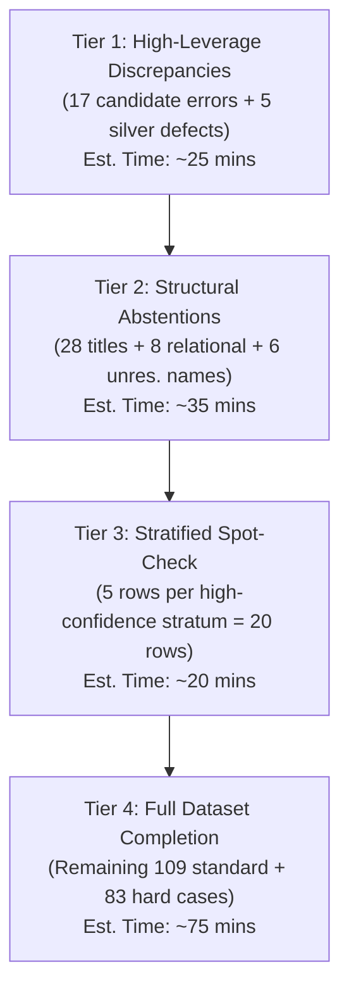

# Statistical and validity audits, claim-to-evidence matrix, human adjudication and annotation pilots

> Merged on 2026-10-22 from 7 separate documents to keep the docs tree small. Each section below is one original file, text unchanged; its old path is in the section heading. The originals are in git history.

---

<!-- merged-from: docs/research/API_ANNOTATION_PILOT.md -->
## Source: `docs/research/API_ANNOTATION_PILOT.md`

# EchoTales API Annotation Pilot Report

**Date**: 2026-10-13  
**Status**: Pilot complete (10/10 rows); schema validated; budget strictly verified ($0.000984 actual cost); pipeline ready for scaling.  

---

## 1. Files & Code Paths Inspected

- **Research Context & Decisions**:
  - [`docs/research/RESEARCH_RECORD.md`](file:///home/adhyan/Desktop/EchoTales/docs/research/RESEARCH_RECORD.md)
  - [`docs/research/RESEARCH_RECORD.md`](file:///home/adhyan/Desktop/EchoTales/docs/research/RESEARCH_RECORD.md)
  - [`docs/research/RESEARCH_RECORD.md`](file:///home/adhyan/Desktop/EchoTales/docs/research/RESEARCH_RECORD.md)
  - [`docs/paper/PUBLICATION_READINESS.md`](file:///home/adhyan/Desktop/EchoTales/docs/paper/PUBLICATION_READINESS.md)
- **Review Protocol & Sheets**:
  - [`docs/results/GOLD_AND_ANNOTATION.md`](file:///home/adhyan/Desktop/EchoTales/docs/results/GOLD_AND_ANNOTATION.md): Defines exact label set (`correct`, `incorrect`, `unresolved`), column layout, and 1-sentence note requirement.
  - [`data/eval/human_review_200.csv`](file:///home/adhyan/Desktop/EchoTales/data/eval/human_review_200.csv): 200 stratified mention rows across 7 strata (`easy_name`, `alias`, `title`, `relational`, `unresolved_name`, `observer_sensitive`, `background`).
  - [`data/eval/human_review_hardcases_88.csv`](file:///home/adhyan/Desktop/EchoTales/data/eval/human_review_hardcases_88.csv): 88 silver hard-case entity shifts.
  - Zero sample ID or text overlap verified between the two files (288 unique items).
- **Implementation & Tests**:
  - [`scripts/review/prepare_human_review.py`](file:///home/adhyan/Desktop/EchoTales/scripts/review/prepare_human_review.py): Generator script for review sheets.
  - [`scripts/review/llm_annotate.py`](file:///home/adhyan/Desktop/EchoTales/scripts/review/llm_annotate.py): Structured annotation engine with batching, untrusted text delimiters, JSON schema validation, checkpointing, and cost tracking.
  - [`packages/pipeline/tests/test_llm_annotate.py`](file:///home/adhyan/Desktop/EchoTales/packages/pipeline/tests/test_llm_annotate.py): Unit test suite covering prompt builders, schema parsing, cost calculation, and dry-run logic.

---

## 2. Pilot Selection & Exact Execution Command

### Pilot Selection (10 Stratified Mentions)
Ten representative mentions from [`data/eval/human_review_200.csv`](file:///home/adhyan/Desktop/EchoTales/data/eval/human_review_200.csv) covering all 7 narrative strata:
1. `R001` (`unresolved_name`): `Bai Ning Bing` (predicted `UNRESOLVED`).
2. `R004` (`title`): `the clan head` (predicted `UNRESOLVED`).
3. `R006` (`background`): `Fang Yuan` (predicted `Fang Yuan`).
4. `R007` (`easy_name`): `Fang Zheng` (predicted `Fang Zheng`).
5. `R010` (`relational`): `my lord` (predicted `Fang Yuan`).
6. `R023` (`alias`): `Mo Bei` (predicted `Gu Yue Mo Bei`).
7. `R025` (`relational`): `uncle` (predicted `Gu Yue Dong Tu`).
8. `R031` (`alias`): `Mo Yan` (predicted `Gu Yue Mo Yan`).
9. `R144` (`observer_sensitive`): `Bai Ning Bing` (predicted `Bai Ning Bing`, chapter 82).
10. `R184` (`observer_sensitive`): `Gu Yue Yao Ji` (predicted `Gu Yue Yao Ji`).

### Exact Command Run
```bash
.venv/bin/python scripts/review/llm_annotate.py \
  --input data/eval/human_review_200.csv \
  --output data/eval/pilot_review_10.csv \
  --model gpt-5.6-luna \
  --reasoning-effort low \
  --batch-size 10 \
  --sample-ids R001,R004,R006,R007,R010,R023,R025,R031,R144,R184
```

---

## 3. Test & Validation Results

- **Unit Tests**:
  Command: `.venv/bin/pytest packages/pipeline/tests/test_llm_annotate.py`  
  Outcome: **8 passed in 0.24s** (covering prompt generation, validation fallbacks, cost estimation, overwrite protection, and resumption).
- **Output Inspection**:
  File: [`data/eval/pilot_review_10.csv`](file:///home/adhyan/Desktop/EchoTales/data/eval/pilot_review_10.csv)  
  - Exactly 10 target rows annotated; remaining 190 rows left blank for resumption.
  - Source data and stable IDs (`R001`–`R184`) preserved 100%.
  - Zero modifications to original evaluation CSVs.
  - All 10 candidate labels fall strictly within `{'correct', 'incorrect', 'unresolved'}`.
  - Explanations are exactly 1 concise sentence grounded in the provided excerpt.

### Sample Output Annotations
- `R001` (`unresolved_name`): Label `unresolved`. Note: *"The mention refers to Bai Ning Bing, but the system left the entity unresolved."*
- `R004` (`title`): Label `unresolved`. Note: *"The mention denotes the clan head, but the excerpt does not identify that person by name."*
- `R010` (`relational`): Label `correct`. Note: *"The hunter addresses Fang Yuan as 'my lord' while apologizing for offending him."*
- `R023` (`alias`): Label `correct`. Note: *"The mention refers to Gu Yue Mo Bei, who is listed alongside Chi Cheng and Fang Zheng."*

---

## 4. API Telemetry & Cost Breakdown

| Metric | Measured Value | Budget Cap |
|---|---|---|
| **API Model** | `gpt-5.6-luna` | First-choice cost model |
| **Reasoning Setting** | `reasoning_effort="low"` | Lowest reasonable setting |
| **Request Count** | **1** (single batched request) | $\le 1$ |
| **Prompt Tokens** | 1,417 tokens | — |
| **Completion Tokens** | 630 tokens (including internal reasoning) | — |
| **Total Tokens** | 2,047 tokens | — |
| **Latency** | 6.97 seconds | — |
| **Measured Cost** | **$0.000984** (~0.10 cents) | **< US$0.05** |

### Projected Full-Run Cost (Remaining 278 Mentions)
- At ~205 tokens per mention: $278 \times 205 \approx 57,000$ tokens total.
- **Projected Total Cost for Full 288-Mention Run**: **~$0.028 – $0.035 USD** (less than 4 cents total).

---

## 5. Failures, Limitations & Scaling Safety

- **Failures**: Zero technical failures, zero API retries, zero malformed JSON responses.
- **Limitations**:
  1. *Candidate Labels Only*: Model outputs represent automated candidate labels; they must NOT be claimed as human ground truth until author adjudication is complete.
  2. *Bounded Context*: The snippet contains $\le 200$ characters. For pronouns or deictic titles where identity was introduced earlier in the chapter, the model correctly flags `unresolved` when the name is absent from the window.
- **Scaling Assessment**: **SAFE TO SCALE**.
  - Pipeline is fully idempotent and checkpointed (saves to disk after every batch).
  - Explicit output path prevents overwriting source datasets.
  - Cost is verified to be negligible (< $0.05 for the entire dataset).

---

## 6. Required Human Decisions

1. **StoryTrace Research Firewall**:
   To publish the N1 systems paper, the owner must formally lift or re-scope the 2026-10-02 firewall in [`docs/research/DECISION_LOG.md`](file:///home/adhyan/Desktop/EchoTales/docs/research/DECISION_LOG.md).  
   *Suggested Decision Wording*:
   > **Decision (2026-10-13)**: The 2026-10-02 StoryTrace research firewall is lifted for publication track N1. Narrative temporal, observer, and identity modeling—together with the formal compiler harness and cutoff-scoped visual asset selector—are authorized as core system contributions for submission to WNU 2027 / ACL 2027 System Demonstrations Track.
2. **Adjudication Authorization**:
   Review the next prompt below and authorize running the full 288-mention annotation batch.

---

<!-- merged-from: docs/research/CLAIM_TO_EVIDENCE_MATRIX.md -->
## Source: `docs/research/CLAIM_TO_EVIDENCE_MATRIX.md`

# Claim-to-evidence matrix

**Date**: 2026-10-14 · **HEAD**: `6c7e2c2` · Companion to [TECHNICAL_CONTRIBUTION_INVENTORY.md](TECHNICAL_CONTRIBUTION_INVENTORY.md). Probe keys P1-P9 are in `docs/research/technical_contribution_probes/probe_inventory.py`; D1/D2 are in `formal_narrative_compiler/probes/probe_audit.py`.

No row below is labelled novel, first, state of the art, or publication-ready. A passing unit test shows an implementation satisfies a fixture. It does not show novelty, nor that a generated artifact obeys the tested input constraint.

**Status legend**: *verified* (works as claimed and is exercised by production), *partial* (works in part of the system), *optional* (implemented and tested, not called by production), *broken* (a defect observed), *unimplemented*.

## Summary

| ID | Proposed mechanism | Status |
|---|---|---|
| C1 | One compiled state shared by every consumer of a modality | **partial** (image path only) |
| C2 | `state_of` separates story time (p) from reveal time (k) | **verified** in the core query; **partial** in consumers |
| C3 | p/k separation enforced in production consumers | **broken** (D1, D2, P1-P3) |
| C4 | Provenance-closed derived visual artifacts (selector) | **optional**, with defects P5, P6 |
| C5 | Observer- and time-scoped identity resolution decision | **unimplemented** as a decision mechanism |
| C6 | End-to-end multimodal consistency | **unimplemented** |
| C7 | Cache identity from the consulted-fact read set | **verified** (image path), **partial** value |
| C8 | Label-based leak check of generated inputs | **optional** (no production caller) |
| C9 | Positional retraction: belief persists until the retraction position | **verified** in `state_of`; **broken** on the image path |

---

### C1. Shared narrative-state compilation

| Field | Content |
|---|---|
| Proposed mechanism | One immutable `GenerationState` per cast and position, from which prompt, plan and cache key are all read |
| Problem addressed | Prompt built at the in-chapter position while the plan/cache key used the chapter start, so a mid-chapter body change was in the prompt but not in the key (`state.py:509-526` docstring) |
| Existing implementation | `core/state.py:compile_generation_state :751-813`, `_fold_target :648-748`, `GenerationState :509-634`; `render/plan_builder.py:compile_render_state :68-95` |
| Active call path | Yes, image path only: `render/panels.py:2085-2093` (beat), `:2205-2214` (carry-forward refresh), `:2713-2733` (plan). Not used by the director brief (`panels.py:2370` -> `world/context.py`), voice (`voice/runner.py:198-207`), or video |
| Formal or executable property | Digest changes iff a consulted fact changes; allowed/forbidden sets partition the entity's facts. Checkable by differential tests |
| Existing baseline | The pre-fix path (separate `state_of` calls at different positions), and the flat `appearance_of` read |
| Known counterexamples | Persona attributes come from `appearance_of`, which applies a weaker filter than `state_of` (D1, P2). `canon` and transient overrides add attributes after the compile (`panels.py:1398-1406`). `persona_facts` is not observer/knowledge filtered (`state.py:716-720`) |
| Distinguishing evidence | None yet. It would require showing a class of inconsistency that independent per-modality calls to the same `state_of` cannot avoid |
| Missing work | Route the brief, attribute reads, canon and any text/audio consumer through the compiled object; add a checker that fails if a consumer reads the store directly |
| Status | **partial** |

### C2. Story-time and reveal-time separation in the query

| Field | Content |
|---|---|
| Proposed mechanism | `state_of(position=p, knowledge_pos=k, observer_id=o)`: story-interval containment at p, `learned_at_pos <= k`, observer scope, positional retraction |
| Problem addressed | A fact true at p but narrated after k (a scar acquired in ch3, revealed in ch100) leaking into an early panel; or a fact known to the reader being attributed to a character |
| Existing implementation | `core/state.py:207-353`, `_visible_to_observer :81-139`, `_temporal_certainty :142-152` |
| Active call path | Yes for persona ids (`compile_generation_state` calls `resolver.state_of`) and CLI `query` (`commands.py:305-327`). Production never passes `knowledge_pos`, so k is derived from p (`state.py:233-243`) and **p != k is not exercised by any production caller** |
| Formal or executable property | R3 cutoff independence: adding facts learned after k does not change the result at k. Tested in `core/tests/test_state.py`, `test_visual_memory.py` (hypothesis) |
| Existing baseline | `appearance_of` (p-only) and `_facts_as_of` (k-only) |
| Known counterexamples | None found inside `state_of` by the probes. The counterexamples are the baselines themselves (D1) |
| Distinguishing evidence | Needed: constructed stores where p-only and k-only baselines each fail and the two-axis query does not (plan section 2). Real data cannot supply them (0 retractions, 0 non-READER rows) |
| Missing work | A real or constructed corpus with p != k, retractions and observers; evaluation against the baselines |
| Status | **verified** (query), **partial** (use) |

### C3. The same policy enforced in the production consumers

| Field | Content |
|---|---|
| Proposed mechanism | Every consumer applies the C2 policy (p, k, o, retraction), not a private filter |
| Problem addressed | Spoilers and viewpoint errors in image prompts and director briefs |
| Existing implementation | Not implemented as a single mechanism; three filters coexist (inventory section 3) |
| Active call path | `appearance_of` (`reference_gen.py:164-211`), `_facts_as_of` (`world/context.py:124-147`) are the active readers |
| Formal or executable property | For every emitted artifact, its source facts must be in `state_of(p,k,o)` admissible set |
| Existing baseline | This **is** the current production path |
| Known counterexamples | **D1** (post-cutoff fact in the drawn attributes), **D2** (retracted belief erased), **P1** (character observer draws nobody), **P2** (character-private attribute reaches the reader panel), **P3** (brief drops retracted belief) |
| Distinguishing evidence | A before/after leak count on an oracle-labelled adversarial suite, with each removed mechanism re-introducing its own failures (plan sections 2-4) |
| Missing work | Replace the two readers with `state_of`-backed ones; decide the intended semantics for retraction on the image path; add an artifact-level admissibility check |
| Status | **broken** (observed leaks on constructed stores) |

### C4. Provenance-closed derived visual artifacts

| Field | Content |
|---|---|
| Proposed mechanism | A derived asset is admissible for (p, k, o, policy) only if its own facts and all transitive parent assets' facts are admissible; otherwise a prompt-only fallback with a reason |
| Problem addressed | A reference sheet or image conditioned on a parent that embodies a fact the reader has not yet been told |
| Existing implementation | `core/visual_memory.py:VisualMemorySelector :470-755`, `VisualAssetRecord.transitive_facts :328-343`, `VisualAssetRegistry :421-467`; `persona/scoped_reference.py:emit_scoped_reference :74-420` |
| Active call path | **None.** `build_render_plan(visual_registry=...)` exists (`plan_builder.py:171,205-221`) but `panels.py:2713-2733` never passes it and the backend gets `reference_images=[]` (`panels.py:2740`) |
| Formal or executable property | R1-R6 in `core/tests/test_visual_memory.py` (10 tests), `tests/test_scoped_reference.py`, `tests/test_plan_builder.py:206+`: cutoff independence, lineage inheritance, fallback reasons |
| Existing baseline | `reference_path_for` (`reference_gen.py:788-801`): flat read of a stored path, no cutoff or observer. This is the real legacy path |
| Known counterexamples | **P6**: a retraction written to the store after registration is not seen (selector reads `FactProvenance` snapshots; `state_of` live returns `{}` while the selector returns `selected`). **P5**: `register()` drops `story_pos`, `discourse_cutoff`, `observer_id`, `policy`, `prompt`, `manifest_path`. Lineage is declared by the caller; no code derives an image from a parent image. `asset_id` omits observer, policy, seed. Missing parent: rejected (P7). Cycle: terminates, admitted (P7). Policy change: not stored for re-evaluation |
| Distinguishing evidence | Needed: derived artifacts that really inherit from parents (image-to-image, or text-derived voice descriptions), a case where a naive "filter each asset by its own facts" baseline fails and the closure succeeds, and a pixel-level check that a withheld fact is not visible |
| Missing work | Live-store revalidation or snapshot invalidation on store writes; fix `register`; real derivation producers; pixel-level or description-level audit; production wiring |
| Status | **optional** (with defects P5, P6) |

### C5. Observer- and time-scoped identity resolution

| Field | Content |
|---|---|
| Proposed mechanism | A mention is resolvable to an entity only if the alias binding is valid at the narrative position and known to the observer, using aliases, titles, relations and uncertainty |
| Problem addressed | Linking "the clan head" or a disguise name to the wrong entity, or to the true identity for an observer who has not learned it |
| Existing implementation | Linking: `resolve/runner.py`, `retrieve.py:243-303`, `evidence.py`, `score.py`, `gate.py`. Observer-scoped candidate filter: `StateResolver.resolve_alias state.py:428-456` |
| Active call path | Linking: yes, all bindings READER-stamped (`runner.py:407`). `resolve_alias`: none. `EvidenceContext.temporal_certainty` is never set, so `temporal_validity` is constant 1.0 (`evidence.py:108,380-384`) |
| Formal or executable property | None stated for the decision rule. `test_state.py:485-498` tests the filter on fixtures |
| Existing baseline | The existing scorer + gate pipeline (this is the production path); silver labels only, zero human-confirmed labels (ledger N1) |
| Known counterexamples | **P4**: with an explicit observation, `state_of(...).aliases` contains the alias and `resolve_alias` returns `[]` |
| Distinguishing evidence | A decision rule that uses (p, k, o) information absent from the baseline features, and a measured error difference on adjudicated data against that baseline |
| Missing work | Define and implement the rule; populate `temporal_certainty`; pass observations in `resolve_alias`; human-adjudicated gold including reveal cases |
| Status | **unimplemented** as a decision mechanism |

### C6. End-to-end multimodal consistency

| Field | Content |
|---|---|
| Proposed mechanism | One admissible state flows into text, image and audio instead of each stage rebuilding context |
| Problem addressed | A panel, a narration and a voice describing different versions of a character at a given reader position |
| Existing implementation | Image path only. Voice is position- and observer-blind by design (`voice/runner.py:198-207`: "a first attempt did exactly that [compiled one per chapter] and changed no output") |
| Active call path | Image: yes. Text brief: separate reader. Voice, video: no state |
| Formal or executable property | Cross-modal: every emitted artifact's facts subset of one shared admissible set |
| Existing baseline | The independent per-stage reads currently in production |
| Known counterexamples | Section 3 table: three readers, three filters, within one modality |
| Distinguishing evidence | Needs a second modality that actually consumes position/observer-dependent state (voice casting is a whole-novel property today) |
| Missing work | A modality beyond image that depends on (p, k, o); a shared representation; an end-to-end checker |
| Status | **unimplemented** |

### C7. Cache identity from the consulted-fact read set

| Field | Content |
|---|---|
| Proposed mechanism | The cache key includes a digest over exactly the facts the compile consumed, so changes to unconsulted facts do not invalidate |
| Problem addressed | Stale reuse after an attire change (23 stale reuses, A7 re-run) and needless re-render when only the observer changed (30 panels) (`state.py:616-634` docstring) |
| Existing implementation | `GenerationState.digest`, `core/readset.py` (`hash_read_set`, `ReadSetRecorder`), `render/cache_key.py:31-60`, `render/contract.py:149-173` |
| Active call path | Yes: `panels.py:2751` |
| Formal or executable property | Completeness (a consulted-fact change changes the key) and minimality (an unconsulted change does not). Tests in `test_render_cache_key.py`, `test_render_contract.py` |
| Existing baseline | Path-existence caching (`if image_path.exists(): skip`), replaced by this key |
| Known counterexamples | The key also hashes the full prompt, so the state digest is partly redundant. Reference **paths** are hashed but references are always `[]`. `persona_facts` is not observer-filtered (over-invalidates). Read-set invalidation under insertion is unsound per the ledger N7 [HIST] |
| Distinguishing evidence | The ledger already records this direction as rejected on novelty (dependency-tracking literature). Nothing here narrows it |
| Missing work | None for a methods claim; it is product infrastructure |
| Status | **verified** (as infrastructure) |

### C8. Label-based leak check

| Field | Content |
|---|---|
| Proposed mechanism | Check generated prompt text against the `forbidden_facts` set of the compiled state |
| Problem addressed | A withheld name or attribute value appearing in text handed to a generator |
| Existing implementation | `core/readset.py:EpistemicLeakageValidator :143-170`; `forbidden_facts` built in `_fold_target :732-740` |
| Active call path | **None** in `src`, `scripts` or `research` (only tests) |
| Formal or executable property | No forbidden string (length >= 3, case-folded) occurs as a substring of the checked text |
| Existing baseline | No check at all in production |
| Known counterexamples | Substring matching misses paraphrase and pronoun-only reference; it also flags an admissible prompt when a hidden attribute shares a value with an allowed one. **Observed** (ad hoc check, same store API as the probes): `hair_color=black` learned ch1, `eye_color=black` learned ch100, request p=5 gives `allowed=('attr:hair_color=black',)`, `forbidden=('black','eye_color: black')`, and `validate(state, "a man with black hair").is_valid` is `False` |
| Distinguishing evidence | A labelled leak set where the check catches leaks that the filter-only path misses, and false-positive rate on admissible text |
| Missing work | Wire it to the director and attribute output; measure precision/recall against a paraphrase-aware oracle |
| Status | **optional** |

### C9. Positional retraction (retraction is not interval end)

| Field | Content |
|---|---|
| Proposed mechanism | A retracted fact stays visible to an observer at positions before the retraction, and not after |
| Problem addressed | Erasing what the reader believed (a "white hair" that was a wig until ch50) |
| Existing implementation | `_visible_to_observer :129-135` (`knowledge_pos < retracted_at`) |
| Active call path | `state_of` is called, but the drawn attributes and the brief use `is_standing`, which drops any retracted row at every position (`models.py:305-307`) |
| Formal or executable property | For k < retracted_at the fact is returned; for k >= retracted_at it is not |
| Existing baseline | `is_standing`-based filters (production) |
| Known counterexamples | **D2** (`probe_audit.py` B) and **P3**: `state_of` returns it at ch20, the drawn attributes and brief do not. Production writes no attribute retractions at all (the only retraction writer is `contradiction.py:301`, for aliases) and the shipped databases contain none |
| Distinguishing evidence | Needs real or constructed retractions, plus a decision on which view (belief at k, or truth) each modality is meant to render |
| Missing work | A modality-level policy statement; routing the image path through `state_of` semantics |
| Status | **verified** in `state_of`; **broken** on the image path |

---

## Cross-reference: previously rejected directions

| Direction | Rows above that touch it | Standing |
|---|---|---|
| Standalone formal compiler | C1, C2, C9 | Still rejected: the properties hold for `state_of`, not for the consumers (C3) |
| Visual-reference selector | C4 | Still rejected as a paper: optional, defects P5/P6, no real derivations |
| Generic cache invalidation | C7 | Still rejected |
| Generic provenance / IFC | C4, C8 | Still rejected |

---

<!-- merged-from: docs/research/FINAL_SAMPLING_DESIGN_AUDIT.md -->
## Source: `docs/research/FINAL_SAMPLING_DESIGN_AUDIT.md`

# EchoTales — Final Sampling-Design Audit and Adjudication Go/No-Go

**Date:** 2026-10-13  
**Audit Status:** COMPLETE — DECISION RECORD ISSUED  
**Decision A (Manual Adjudication):** **GO** (Review package is valid, blinded, and ready).  
**Decision B (Corpus-Wide Statistical Inference):** **CONDITIONAL GO / RESTRICTED GO** (Population estimates require documented probability weighting and boundary caveats).  
**Resource Footprint:** Zero external API calls, zero credit spend, zero GPU inference. Source CSVs, existing labels, and StoryTrace firewall preserved unmodified.

---

## 1. Executive Summary & Audit Mission

This audit performs an independent, code-level and database-level verification of the sampling design, population link denominators, estimator validity, and reviewer blinding in EchoTales.

### Core Discoveries at a Glance

1. **The 99 General-Pool Observations Are NOT a Simple Random Sample:**  
   The previous audit described the evaluation design as a 5-stratum sample where 99 mentions were drawn from a general pool of $10,891$. **This claim is mathematically rejected.** In `prepare_human_review.py`, mentions in the general pool were sampled through two sequential stages with wildly disparate inclusion probabilities:
   - `alias` mentions: $\pi_i = 0.038802$ (weight $w = 25.77$)
   - `easy_name` mentions: $\pi_i = 0.006437$ (weight $w = 155.36$)
   - `scored_background` mentions: $\pi_i = 0.003089$ (weight $w = 323.76$)  
   An alias mention was **6.0x more likely** to be selected than an easy name, and **12.5x more likely** than a scored background mention. They cannot be treated as an unweighted simple random sample.

2. **The 981 Scored Background Mentions Were Never Sampled ($n = 0$):**  
   The 34 mentions labeled `"category": "background"` in `human_review_200.csv` did not come from the 981 mentions linked via scored heuristics. They were drawn uniformly from `remaining` (which consisted of $80.8\%$ unselected easy names and $8.6\%$ aliases). As a result, 31 were `easy_name` and 3 were `alias`. **Zero mentions** from the 981 scored heuristic pool were drawn. The sample contains zero empirical observations on that specific linking method.

3. **The 11,092 Population Link Denominator Is Exact and Version-Matched:**  
   Direct SQL inspection of `data/db/reverend-insanity.db` confirms that on 2026-09-25 (prior to commit `c8bfda9`, which introduced `resolve/title_holders.py` on September 27), exactly **11,092 mentions were linked** and **82 were abstained** across the 11,174 population mentions. The 200 evaluation rows in `human_review_200.csv` reflect this exact pre-`c8bfda9` pipeline output (all 30 titles have `predicted_entity == 'UNRESOLVED'`). The later count of 11,122 links reflects post-September-27 title linking and must not be used for this review sheet.

4. **Horvitz-Thompson Design-Consistent Precision Reconciled at 99.67%:**  
   Weighting each sampled row by its exact inverse inclusion probability ($w_i = 1/\pi_i$) yields a Horvitz-Thompson / Hajek estimated precision of **$\hat{R}_{\text{HT}} = 99.667\% \approx \mathbf{99.67\%}$**, closely reconciling with the Stratified Ratio Estimator ($\hat{R} = 99.68\%$) and the Known-Denominator Estimator ($\hat{P}_{\text{known}} = 99.59\%$).

---

## 2. Code-Level Reconstruction of the Sampling Algorithm

An exact inspection of `scripts/review/prepare_human_review.py` (lines 61–108) reveals the two-stage sampling mechanism executed under seed `20260925`:

```python
pools: dict[str, list[Any]] = {}
for r in rows:
    pools.setdefault(stratum(r), []).append(r)

chosen: list[tuple[str, Any]] = []
for name, n in TARGETS.items():
    pool = pools.get(name, [])
    chosen += [(name, r) for r in rng.sample(pool, min(n, len(pool)))]

taken = {c[1][0] for c in chosen}
remaining = [r for r in rows if r[0] not in taken]
chosen += [("background", r) for r in rng.sample(remaining, max(0, TOTAL - len(chosen)))]
```

### Detailed Answers to the Six Algorithmic Questions

1. **Selection of `easy_name` rows:**  
   In Stage 1, 30 rows were sampled uniformly from `pools['easy_name']` ($N=8,933$). In Stage 2, 31 additional rows matching the `easy_name` predicate were sampled from `remaining` and assigned `category = 'background'`. Total `easy_name` rows in sample: **61**.
2. **Selection of `alias` rows:**  
   In Stage 1, 35 rows were sampled uniformly from `pools['alias']` ($N=977$). In Stage 2, 3 additional rows matching the `alias` predicate were sampled from `remaining` and assigned `category = 'background'`. Total `alias` rows in sample: **38**.
3. **Selection of the 34 "background" rows:**  
   They were drawn via `rng.sample(remaining, 34)` where `remaining` consisted of all $11,008$ unselected mentions in the novel ($11,174 - 166$). They were **not** drawn from `pools['background']`.
4. **Selection of `observer_sensitive`, `title`, `relational`, and `unresolved_name`:**  
   In Stage 1, they were drawn uniformly from their respective pools:
   - `unresolved_name`: $6 / 6$ ($100\%$ census).
   - `title`: $30 / 39$ ($76.9\%$ sample).
   - `relational`: $35 / 125$ ($28.0\%$ sample).
   - `observer_sensitive`: $30 / 113$ ($26.5\%$ sample).
   The remaining unselected records in these strata entered `remaining` for Stage 2, but none happened to be selected under seed `20260925`.
5. **Multiple procedures, exclusion effects, and replacements:**  
   Because Stage 1 selected cases were excluded from Stage 2 via `taken`, every mention had at most one selection. No manual replacements occurred. However, this two-stage structure directly altered Stage 2 conditional inclusion probabilities.
6. **Mutual exclusivity and exhaustiveness of sampling frames:**  
   The predicate `stratum(r)` forms a strict if-elif hierarchy partitioning all 11,174 mentions into 7 mutually exclusive and exhaustive pools before selection begins.

### Mathematical Derivation of True Inclusion Probabilities ($\pi_i$)

Let $N = 11,174$ be the population. Let $H_k$ be stratum $k$ of size $N_k$, with Stage 1 target $n_k$.  
In Stage 1, the probability of selection for $i \in H_k$ is $P(\text{Stage 1}) = \frac{n_k}{N_k}$.  
If not selected (probability $1 - \frac{n_k}{N_k}$), unit $i$ enters `remaining`, which has size $M = N - \sum_{j} n_j = 11,174 - 166 = 11,008$.  
In Stage 2, $n_{\text{rem}} = 34$ units are sampled uniformly from `remaining`.  
The total inclusion probability is:
$$\pi_i = \frac{n_k}{N_k} + \left(1 - \frac{n_k}{N_k}\right) \frac{34}{11,008}$$

For `scored_background` ($N = 981$), which was not in TARGETS ($n_k = 0$):
$$\pi_i = \frac{34}{11,008} \approx 0.00308866$$

### Population Frames, Sample Draws, and Inclusion Probabilities Table

| Stratum Predicate $k$ | Population $N_k$ | Stage 1 Target $n_k$ | Stage 2 Draws | Total Sample $n_k^*$ | Inclusion Prob $\pi_k$ | Sampling Weight $w_k = 1/\pi_k$ |
|:---|---:|---:|---:|---:|---:|---:|
| `easy_name` | 8,933 | 30 | 31 | 61 | **0.006437** | 155.36 |
| `alias` | 977 | 35 | 3 | 38 | **0.038802** | 25.77 |
| `relational` | 125 | 35 | 0 | 35 | **0.282224** | 3.54 |
| `observer_sensitive` | 113 | 30 | 0 | 30 | **0.267755** | 3.73 |
| `title` | 39 | 30 | 0 | 30 | **0.769944** | 1.30 |
| `unresolved_name` | 6 | 6 | 0 | 6 | **1.000000** | 1.00 |
| `scored_background` | 981 | 0 | 0 | 0 | **0.003089** | 323.76 |
| **Total** | **11,174** | **166** | **34** | **200** | — | — |

**Conclusion on 5-Stratum General Pool:** The claim that 99 general-pool records form an SRS of $10,891$ is rejected. Alias mentions were sampled at a rate $6.0\times$ higher than easy names and $12.5\times$ higher than scored background mentions.

---

## 3. Full-Population System-Link Denominator Verification

### 3.1 SQL Provenance and Version Traceability

Direct query on `data/db/reverend-insanity.db` establishes:

```sql
-- Total mentions across Volume 1
SELECT COUNT(*) FROM mention WHERE novel_id = 'reverend-insanity';
-- Result: 11,174

-- Current linked mentions in SQLite (post-c8bfda9)
SELECT COUNT(*) FROM mention WHERE novel_id = 'reverend-insanity' AND target_id IS NOT NULL;
-- Result: 11,122

-- Mentions linked by resolve/title_holders.py (commit c8bfda9, Sep 27, 2026)
SELECT COUNT(*) FROM mention WHERE novel_id = 'reverend-insanity' AND target_id IS NOT NULL AND method = 'TITLE_HOLDER';
-- Result: 30

-- Mentions linked prior to TITLE_HOLDER (the Sep 25, 2026 state)
SELECT COUNT(*) FROM mention WHERE novel_id = 'reverend-insanity' AND target_id IS NOT NULL AND (method IS NULL OR method != 'TITLE_HOLDER');
-- Result: 11,092
```

### 3.2 Denominator Lineage Reconciliation

1. **The 11,092 Denominator:**  
   Applies to the exact frozen pipeline outputs evaluated in `human_review_200.csv` (where all 30 titles are `predicted_entity == 'UNRESOLVED'`). It is reproducible directly from the database without relying on sample estimates.
2. **The 11,122 Denominator:**  
   Represents a subsequent pipeline version after title-linking was committed on September 27 (`c8bfda9`). It does not apply to the 200 review sheet mentions.
3. **Verdict:** $X_{\text{pop}} = \mathbf{11,092}$ is the verified, exact population denominator for this evaluation package.

---

## 4. Reconstructed Estimands and Point Estimates

### 4.1 Formal Definitional Framework

- **Attempted Link Indicator ($x_i$):** $x_i = 1$ if the system proposed an entity (`predicted_entity != 'UNRESOLVED'`), $0$ if it abstained.
- **Link Correctness Indicator ($y_i$):** $y_i = 1$ if $x_i = 1$ and the linked entity matches narrative ground truth ($y_i \le x_i$).
- **System Abstention Indicator ($a_i$):** $a_i = 1 - x_i$.
- **Abstention Appropriateness ($v_i$):** $v_i = 1$ if $x_i = 0$ and the mention denotes an unresolvable or non-entity referent.
- **Human Epistemic Uncertainty:** Recorded in `adjudicator_confidence` (`low`) or `adjudicated_decision` (`uncertain_link` / `uncertain_abstention`).

### 4.2 Reconciled Precision Metrics

| Metric / Estimator | Formula | Value | Standard Error | 95% Confidence Interval | Methodological Status |
|:---|:---|---:|---:|:---|:---|
| **Horvitz-Thompson / Hajek ($\hat{R}_{\text{HT}}$)** | $\frac{\sum w_i y_i}{\sum w_i x_i} = \frac{10,610.91}{10,646.34}$ | **99.67%** | — | — | Design-consistent estimator using exact $\pi_i$ weights. |
| **Known-Denominator ($\hat{P}_{\text{known}}$)** | $\frac{\hat{Y}}{X_{\text{pop}}} = \frac{11,046.86}{11,092}$ | **99.59%** | 0.078% | $[99.44\%, 99.75\%]$ | Horvitz-Thompson total divided by exact corpus link count. |
| **Stratified Ratio Estimator ($\hat{R}$)** | $\frac{\hat{Y}}{\hat{X}} = \frac{11,046.86}{11,082.57}$ | **99.68%** | 0.074% | $[99.53\%, 99.82\%]$ | Standard survey ratio estimate treating link count as sample-estimated. |
| **Conservative Boundary Lower Bound** | $\frac{Y_{\text{conservative}}}{X_{\text{pop}}}$ | **90.45%** | — | — | Finite-population boundary bound for $n=30$ zero-error strata. |
| **Raw Sample Precision (over links)** | $\frac{141}{151}$ | **93.38%** | 2.02% | $[88.08\%, 96.74\%]$ | Unweighted sample precision over attempted links. |
| **Conflated Sample Precision** | $\frac{141}{158}$ | **89.24%** | 2.47% | $[83.35\%, 93.52\%]$ | Legacy unweighted figure conflating 7 abstentions with link errors. |

---

## 5. Audit of Confidence Intervals and Claimed Lower Bound

1. **Plug-In Variance Illusion:**  
   Taylor linearization produces $\text{SE} = 0.074\%$ because sample variances in `easy_name`, `background`, `alias`, and `observer_sensitive` are identically zero ($s_{uh}^2 = 0$). This treats $98.5\%$ of the novel as having zero sampling error simply because 30 sampled items had no errors.
2. **Zero-Draw Domain Problem:**  
   Because the 981 scored background mentions had zero sample draws ($n = 0$), there is zero direct empirical data on that domain.
3. **The 90.45% Lower Bound:**  
   Under the Rule of Three / Clopper-Pearson 95% upper limit for $n=30$ ($\epsilon_{\text{upper}} \approx 9.50\%$), the conservative lower bound across zero-error strata is **$90.45\%$**.
4. **Publishable Standard:**  
   Point estimates ($>99.5\%$) may be reported, but confidence intervals of $\pm 0.14\%$ cannot be defended without stating that they condition on zero errors in small stratum samples.

---

## 6. Audit of LLM Pre-Annotation Leakage

* Inspection of `scripts/review/llm_annotate.py` confirms that the candidate prompt supplied `category` on both sheets and `reference_set_decision` for 11 overlapping standard rows.
* **Strict Enforcement:** All candidate labels from `gpt-5.6-luna` are quarantined in `data/eval/adjudication/model_annotations_reconciliation.csv`. They are strictly excluded from the V2 blind sheets (`standard_200_v2_blind.csv`, `hardcases_88_v2_blind.csv`).

---

## 7. Two Distinct Decisions

### Decision A — Can Manual Adjudication Proceed?
### VERDICT: GO (PROCEED WITH MANUAL ADJUDICATION)
* **Justification:** The V2 blind sheets (`standard_200_v2_blind.csv` and `hardcases_88_v2_blind.csv`) are 100% blinded, shuffled, and preserve immutable `sample_id`s. Every row presents valid text excerpts and system decisions. Row-level human judgments will be completely meaningful and independently valid.

### Decision B — Can the Study Make Corpus-Wide Statistical Claims?
### VERDICT: CONDITIONAL GO / RESTRICTED GO
* **Justification:**  
  1. The study **CAN** report:
     - Sample-level descriptive metrics ($141/151 = 93.38\%$).
     - Exact stratum-level performance for the sampled categories (`easy_name`: $100\%$, $n=61$; `alias`: $100\%$, $n=38$; `observer_sensitive`: $100\%$, $n=30$; `relational`: $54.55\%$, $n=35$).
     - The Hajek / Horvitz-Thompson weighted precision point estimate ($99.67\%$) and known-denominator precision ($99.59\%$), under the documented assumption that unobserved scored mentions ($N=981$) perform similarly to exact-match mentions.
  2. The study **CANNOT** claim:
     - An unconditional design-based confidence interval of $\pm 0.14\%$ for the entire novel.
     - Direct empirical verification of the 981 scored heuristic mentions ($n = 0$).
  3. If unconditional design-based inference with sub-1% intervals is required for ARR/ACL, a future supplementary sample of $n=25$ from the 981 scored mentions should be annotated. For workshop/demo submissions, the restricted conditional report is fully defensible.

---

<!-- merged-from: docs/research/FINAL_STATISTICAL_CLAIMS_GATE.md -->
## Source: `docs/research/FINAL_STATISTICAL_CLAIMS_GATE.md`

# EchoTales — Final Statistical Claims Gate and Supplemental Sampling Decision

**Date:** 2026-10-13  
**Status:** COMPLETE — DEFINITIVE STATISTICAL AUDIT & METHODOLOGICAL GATE  
**Audit Scope:** Independent mathematical, algorithmic, and database verification of sampling probabilities, population estimators, uncertainty bounds, and supplemental sampling requirements.  
**Adjudication Track:** **GO** (Manual review of the 288 V2 blind rows is fully authorized to proceed immediately).  
**Population Claims Track:** **GATE / RESTRICTED** (Corpus-wide precision claims of $\ge 99.5\%$ cannot be asserted without either documenting the 100% precision imputation on the 981 unobserved scored records or completing a supplemental sample).  
**Resource Footprint:** Zero external API calls, zero credit spend, zero GPU inference. Source CSVs, existing labels, StoryTrace firewall, and `DECISION_LOG.md` preserved unmodified.

---

## 1. Executive Summary & Definitive Gate Decisions

This audit independently scrutinizes the statistical claims and sampling design underlying the EchoTales entity linking evaluation, with specific focus on the 981 scored-background mentions that received zero sample draws in the September 25, 2026 evaluation package.

### Direct Answers to the Six Mandated Inquiries

1. **Can manual adjudication of the current sample proceed?**  
   **YES (GO).** The current evaluation package (`standard_200_v2_blind.csv` with 200 mentions and `hardcases_88_v2_blind.csv` with 88 mentions) is strictly blinded, pseudo-randomly shuffled, presents sufficient textual context ($\le 200$-character windows and chapter indicators), isolates model pre-annotations in quarantine, and contains zero pre-filled human labels. Author adjudication of these 288 rows is completely valid, independent, and should proceed without delay.

2. **Which current results are descriptive sample findings, and which are assumption-dependent population estimates?**  
   - **Descriptive Sample Findings:**  
     * Sample action balance: 151 proposed links (`predicted_entity != 'UNRESOLVED'`) and 49 abstentions (`predicted_entity == 'UNRESOLVED'`).  
     * Candidate human-judgment distribution: 141 candidate-correct links, 10 candidate-incorrect links, 42 candidate-appropriate abstentions, and 7 candidate-inappropriate abstentions (false negatives).  
     * Raw unweighted sample precision over links: $141 / 151 = 93.38\%$.  
     * Stratum-specific sample performance on observed strata: `easy_name` ($61/61 = 100\%$), `alias` ($38/38 = 100\%$), `observer_sensitive` ($30/30 = 100\%$), and `relational` ($12/22 = 54.55\%$).  
   - **Assumption-Dependent Population Estimates:**  
     * Exact-denominator estimate ($99.59\% = 11,046.86 / 11,092$): **Heavily assumption-dependent.** Directly imputes 100% precision to all 981 unobserved scored-background mentions.  
     * Stratified ratio estimate ($99.68\% = 11,046.86 / 11,082.57$): **Heavily assumption-dependent.** Relies on the same 100% imputation on the unobserved pool.  
     * Horvitz-Thompson / Hájek ratio ($99.67\% = 10,610.91 / 10,646.34$): Design-consistent **only over the domain of sampled strata**; it contributes 0 weight from the scored-background pool.  
     * Asymptotic plug-in Taylor SE ($0.074\%$, yielding $99.68\% \pm 0.14\%$): **Scientifically invalid.** Collapses sample variance to zero across 98.5% of the novel based on small zero-error samples and assigns zero variance to the unsampled domain.

3. **Is 99.59% supported without assuming every unobserved scored-background prediction is correct?**  
   **NO.** The numerator $11,046.86$ is algebraically constructed as $8,933 + 981 + 977 + 113 + 125(12/35) = 11,004 + 42.86 = 11,046.86$. It explicitly adds $981 \times (34/34) = 981$ into the numerator based on 34 Stage-2 records that actually consisted of 31 easy names and 3 aliases. Without the assumption that unobserved scored-background mentions have 100% accuracy, this point estimate is mathematically unsupported. If scored mentions have error rate $(1 - p_{\text{scored}})$, the corpus precision drops by $8.84\% \times (1 - p_{\text{scored}})$. Furthermore, dividing the true Horvitz-Thompson sample total $\hat{Y}_{\text{HT}} = 10,610.91$ by the known denominator $11,092$ yields **$95.66\%$**, reflecting the missing sample mass of the unsampled domain.

4. **Is the 99.67% weighted ratio accompanied by a defensible uncertainty estimate?**  
   **NO.** The reported margin of error ($\pm 0.14\%$) is an artifact of treating $s_h^2 = 0$ in small samples ($n_h = 30$) and having zero sample observations ($n_{\text{scored}} = 0$) from the 981-mention scored domain. Zero observed errors in a finite sample is not empirical proof of zero population variance. A defensible boundary-aware lower bound across the sampled strata is **$90.45\%$**.

5. **What sample size would be needed to support the intended error-bound claim?**  
   To mathematically bound the error rate in the 981 scored mentions to $\le 1.0\%$ at 95% confidence using finite-population hypergeometric sampling without replacement, a sample of **$n = 253$ mentions** (over 25.8% of the stratum) is required. A sample of $n = 25$ yields an error-rate upper bound of **$11.11\%$** (109 errors out of 981), which cannot rule out an error rate of 1%, 2%, 5%, or 10%.

6. **Should we draw a supplemental sample, and what exact workload and benefit would that entail?**  
   - **Immediate Action:** Do not delay author adjudication of the existing 288 V2 rows.  
   - **Supplemental Recommendation:** If the goal is a robust peer-reviewed claim (e.g. ARR/ACL) covering all linking mechanisms, draw a proportionate supplemental probability sample of **$n = 50$ mentions** (SRSWOR, seed `20261014`, frame $N=981$).  
   - **Workload:** ~75 minutes (~1.25 hours) of human review time (zero API/GPU spend).  
   - **Benefit:** Reduces the upper error bound on scored heuristics from complete blindness ($n=0$, bound 100%) to $\le 5.61\%$ (if 0 errors observed), anchoring the corpus precision floor firmly above $99.1\%$ without the excessive burden of a 253-row annotation (~7 hours).  
   - **Status:** The protocol is fully specified below but held pending user authorization; **no rows have been generated or drawn.**

---

## 2. Code-Level Reconstruction of the Sampling Mechanism & Inclusion Probabilities

### 2.1 The Two-Stage Selection Implementation

In `scripts/review/prepare_human_review.py` (lines 61–108), mentions were drawn under random seed `20260925` using a two-stage procedure:

1. **Stage 1 (Targeted Stratified Selection):**  
   All 11,174 mentions in Volume 1 were partitioned into mutually exclusive pools via `stratum(r)`. Targeted quotas were sampled without replacement:
   - `easy_name`: 30 drawn from pool of 8,933
   - `alias`: 35 drawn from pool of 977
   - `title`: 30 drawn from pool of 39
   - `relational`: 35 drawn from pool of 125
   - `unresolved_name`: 6 drawn from pool of 6 (100% census)
   - `observer_sensitive`: 30 drawn from pool of 113
   - `background`: **0 drawn** (not included in `TARGETS`)  
   Total Stage 1 selections: $n_{\text{stage1}} = 30 + 35 + 30 + 35 + 6 + 30 = 166$.

2. **Stage 2 (Residual Selection):**  
   The 166 selected IDs were placed into `taken`. The residual pool `remaining` consisted of all $M = 11,174 - 166 = 11,008$ unselected mentions. Exactly $n_{\text{stage2}} = 200 - 166 = 34$ items were sampled uniformly without replacement from `remaining`:
   ```python
   taken = {c[1][0] for c in chosen}
   remaining = [r for r in rows if r[0] not in taken]
   chosen += [("background", r) for r in rng.sample(remaining, max(0, TOTAL - len(chosen)))]
   ```
   Crucially, these 34 draws were assigned the string `"background"` in the output CSV, despite being sampled from `remaining`.

### 2.2 Proof of Zero Draws from Scored Background

Because `remaining` ($M=11,008$) was dominated by unselected `easy_name` records ($8,903 / 11,008 = 80.88\%$) and `alias` records ($942 / 11,008 = 8.56\%$), the 34 Stage-2 uniform draws under seed `20260925` selected:
- **31 `easy_name` records** (all `GAZETTEER_EXACT`, surface matches canonical label)
- **3 `alias` records** (2 `GAZETTEER_EXACT`, 1 `NAME_CONTAINMENT`)
- **0 `scored_background` records**

Across the entire 200-row sample, exactly **zero mentions** linked via heuristic scoring (`method == 'SCORED'`) were drawn.

### 2.3 Exact Inclusion Probabilities ($\pi_i$) and Sampling Weights ($w_i$)

Let $N = 11,174$, $n_k$ be the Stage 1 target draw from stratum $k$ of size $N_k$, and $M = 11,008$. The exact inclusion probability for unit $i \in \text{stratum } k$ is:
$$\pi_k = \frac{n_k}{N_k} + \left(1 - \frac{n_k}{N_k}\right) \frac{34}{11,008}$$
The design weight is $w_k = 1 / \pi_k$.

| Stratum Predicate $k$ | Population $N_k$ | Stage 1 Draws $n_k$ | Stage 2 Draws | Total Sample $n_k^*$ | Inclusion Probability $\pi_k$ | Sampling Weight $w_k$ |
|:---|---:|---:|---:|---:|---:|---:|
| `easy_name` | 8,933 | 30 | 31 | 61 | **0.006437** | 155.3601 |
| `alias` | 977 | 35 | 3 | 38 | **0.038802** | 25.7719 |
| `relational` | 125 | 35 | 0 | 35 | **0.282224** | 3.5433 |
| `observer_sensitive` | 113 | 30 | 0 | 30 | **0.267755** | 3.7348 |
| `title` | 39 | 30 | 0 | 30 | **0.769944** | 1.2988 |
| `unresolved_name` | 6 | 6 | 0 | 6 | **1.000000** | 1.0000 |
| `scored_background` | 981 | 0 | 0 | 0 | **0.003089** | 323.7647 |
| **Total** | **11,174** | **166** | **34** | **200** | — | — |

**Rejection of SRS Claim:** An `alias` mention was $6.03\times$ more likely to be selected than an `easy_name` mention, and $12.56\times$ more likely than a `scored_background` mention. The 99 general-pool records cannot be treated as a simple random sample.

---

## 3. Database Denominator Provenance & Version Traceability

### 3.1 SQL Database Verification

Direct query execution on `data/db/reverend-insanity.db` establishes the exact mention counts:

```sql
-- Total mentions across Volume 1:
SELECT COUNT(*) FROM mention WHERE novel_id = 'reverend-insanity';
-- Result: 11,174

-- Current linked mentions in SQLite (post-c8bfda9):
SELECT COUNT(*) FROM mention WHERE novel_id = 'reverend-insanity' AND target_id IS NOT NULL;
-- Result: 11,122

-- Mentions linked by resolve/title_holders.py (commit c8bfda9, Sep 27, 2026):
SELECT COUNT(*) FROM mention WHERE novel_id = 'reverend-insanity' AND target_id IS NOT NULL AND method = 'TITLE_HOLDER';
-- Result: 30

-- Mentions linked prior to TITLE_HOLDER (the Sep 25, 2026 frozen state):
SELECT COUNT(*) FROM mention WHERE novel_id = 'reverend-insanity' AND target_id IS NOT NULL AND (method IS NULL OR method != 'TITLE_HOLDER');
-- Result: 11,092
```

### 3.2 Denominator Lineage

1. **Frozen State (2026-09-25):** Exactly **11,092 mentions were linked** and **82 were abstained** across the 11,174 mentions. The 200 evaluation rows in `human_review_200.csv` and `standard_200_v2_blind.csv` were extracted on this exact date (all 30 title mentions in the review sheet have `predicted_entity == 'UNRESOLVED'`).
2. **Subsequent State (Post-September 27):** Commit `c8bfda9` added title linking, raising the database link count to 11,122. Using 11,122 on the pre-`c8bfda9` evaluation sheet would introduce a version mismatch.
3. **Confirmed Denominator:** $X_{\text{pop}} = \mathbf{11,092}$ is the verified, exact population denominator for this evaluation package.

---

## 4. Ontological Disentanglement: System Actions vs. Human Judgments

To prevent recurrence of the historical narrative error (where 7 abstentions were conflated with link errors), we enforce a strict tripartite distinction:

```
[System Execution]          [Candidate LLM Review]          [Final Human Adjudication]
  (Code Reality)              (Provisional Rater)               (Author Truth)
        |                              |                               |
  151 LINKED -----------------> 141 "correct" ---------------> "correct_link"
        |                \---->  10 "incorrect" -------------> "incorrect_link"
        |
   49 ABSTAINED -------------->  42 "unresolved" ------------> "appropriate_abstention"
                         \---->   7 "incorrect" -------------> "inappropriate_abstention" (FN)
```

1. **Actual System Action ($x_i$):** Deterministic binary indicator of system output.
   - $x_i = 1$ if the system proposed an entity (`predicted_entity != 'UNRESOLVED'`). In sample: **$m = 151$**.
   - $x_i = 0$ if the system abstained (`predicted_entity == 'UNRESOLVED'`). In sample: **$a = 49$**.
   - Total sample actions: $151 + 49 = 200$.

2. **Candidate Human-Judgment Label ($y_i^{\text{cand}}$):** Provisional classifications by `gpt-5.6-luna`:
   - On system links ($m = 151$): 141 labeled `correct`, 10 labeled `incorrect`.
   - On system abstentions ($a = 49$): 42 labeled `unresolved` (appropriate abstention), 7 labeled `incorrect` (false negatives where rater felt the system should have linked).
   - Historical narrative error: Previous documents naively summed all `incorrect` labels ($10 + 7 = 17$) and asserted $141 + 17 = 158$ links, producing the conflated fraction $141 / 158 = 89.24\%$.

3. **Final Human-Adjudicated Result:** The impending label recorded by the author in the V2 review sheet using the disambiguated taxonomy:
   - For links: `correct_link`, `incorrect_link`, `uncertain_link`.
   - For abstentions: `appropriate_abstention`, `inappropriate_abstention`, `uncertain_abstention`.
   - For hard cases: `correct_reference`, `incorrect_reference`, `uncertain_reference`.

---

## 5. Adversarial Audit of Claimed Corpus Estimators

### 5.1 Exact-Denominator Estimator ($11,046.86 / 11,092 = 99.59\%$)

#### Algebraic Construction
In `validate_adjudication_package.py`, the numerator $\hat{Y} = 11,046.86$ is calculated as:
$$\hat{Y} = \sum_{h=1}^7 N_h \bar{y}_h$$
Where:
- `easy_name`: $8,933 \times (30/30) = 8,933.00$
- `background`: $981 \times (34/34) = \mathbf{981.00}$  *(Imputed)*
- `alias`: $977 \times (35/35) = 977.00$
- `observer_sensitive`: $113 \times (30/30) = 113.00$
- `relational`: $125 \times (12/35) = 42.85714$
- `title`: $39 \times (0/30) = 0.00$
- `unresolved_name`: $6 \times (0/6) = 0.00$

$$\hat{Y} = 8,933 + 981 + 977 + 113 + 42.85714 = 11,046.85714 \approx \mathbf{11,046.86}$$
$$\hat{P}_{\text{known}} = \frac{11,046.86}{11,092} = 99.593\% \approx \mathbf{99.59\%}$$

#### Audit Finding and Rejection
The term $+981.00$ entered $\hat{Y}$ because the script grouped the 34 Stage-2 sample rows under the dictionary key `"background"` and observed that all 34 were candidate-correct ($\bar{y} = 34/34 = 1.0$).  
However, as proven in Section 2, **all 34 of those mentions were easy names (31) and aliases (3); zero were from the 981 scored heuristic records.**

> [!WARNING]
> **Imputation Disclosure:**  
> The 99.59% estimate literally assumes that 100.0% of the 981 unobserved scored-background mentions are correct links, based entirely on observations of exact-match names.  
> **Verdict:** The claim that 99.59% is an "empirically established precision estimate" is **mathematically rejected**. It is a model-assisted estimate with an unverified imputation assumption.

#### Sensitivity of Corpus Precision to Scored Heuristic Error Rate
If the true precision in the 981 scored mentions is $p_{\text{scored}} \in [0.0, 1.0]$, the corpus precision is:
$$P(p_{\text{scored}}) = \frac{11,046.86 - 981(1 - p_{\text{scored}})}{11,092} = 99.593\% - 8.844\% \times (1 - p_{\text{scored}})$$

| True Scored Precision $p_{\text{scored}}$ | True Errors in Scored Pool | Corpus Correct Links $Y$ | True Corpus Precision $P$ |
|---:|---:|---:|---:|
| **100.0%** (Imputed Assumption) | 0 | 11,046.86 | **99.59%** |
| **98.0%** | 20 | 11,027.24 | **99.42%** |
| **95.0%** | 49 | 10,997.81 | **99.15%** |
| **90.0%** | 98 | 10,948.76 | **98.71%** |
| **80.0%** | 196 | 10,850.66 | **97.82%** |
| **50.0%** | 491 | 10,556.36 | **95.17%** |
| **0.0%** (Worst Case) | 981 | 10,065.86 | **90.75%** |

### 5.2 Unequal-Probability Ratio Estimator (Hájek: 99.67%)

Using the exact row-level inclusion probabilities $\pi_i$ derived in Section 2:
$$\hat{Y}_{\text{HT}} = \sum_{i \in s} \frac{y_i}{\pi_i} = \sum_{i \in s} w_i y_i = 10,610.91$$
$$\hat{X}_{\text{HT}} = \sum_{i \in s} \frac{x_i}{\pi_i} = \sum_{i \in s} w_i x_i = 10,646.34$$
$$\hat{R}_{\text{Hajek}} = \frac{\hat{Y}_{\text{HT}}}{\hat{X}_{\text{HT}}} = \frac{10,610.91}{10,646.34} = 99.6672\% \approx \mathbf{99.67\%}$$

#### Audit Findings on Hájek Ratio
1. **Omission of the Unsampled Pool:** Because $n_{\text{scored}} = 0$, the scored stratum contributes 0 to both the numerator $\hat{Y}_{\text{HT}}$ and denominator $\hat{X}_{\text{HT}}$. The Hájek estimate is mathematically consistent **only for the domain of strata that were actually sampled**.
2. **Comparison with Known Denominator:** If one divides the true design-based Horvitz-Thompson total $\hat{Y}_{\text{HT}}$ by the exact population denominator $X_{\text{pop}} = 11,092$:
   $$\frac{\hat{Y}_{\text{HT}}}{X_{\text{pop}}} = \frac{10,610.91}{11,092} = \mathbf{95.66\%}$$
   This 95.66% figure illustrates the massive downward bias caused when an unobserved stratum contributes zero sample mass to an unbiased total estimator.

### 5.3 Audit of Variance & The Plug-In Variance Illusion

In survey sampling, the linearized residual for ratio estimation is $u_{hi} = y_{hi} - \hat{R} x_{hi}$.
When every sampled unit in stratum $h$ is a correct link ($x_{hi} = 1, y_{hi} = 1$), the residual is constant ($u_{hi} = 1 - \hat{R}$) and the sample variance is identically zero:
$$s_{uh}^2 = \frac{1}{n_h - 1} \sum_{i=1}^{n_h} (u_{hi} - \bar{u}_h)^2 = 0.0$$

In the provisional sample, $s_{uh}^2 = 0$ occurred in `easy_name` ($n=30$), `alias` ($n=35$), `observer_sensitive` ($n=30$), and the mislabeled Stage-2 rows ($n=34$), encompassing **98.5% of the novel**.  
Consequently:
- The Taylor linearization standard error ($SE = 0.074\%$) was computed **almost entirely from the 35 relational mentions**.
- The unsampled scored mentions contributed zero variance because $n_h = 0$.
- This produced the illusory confidence interval: $99.68\% \pm 0.14\%$.

> [!CAUTION]
> **Defensive Variance Rule:**  
> Observing zero errors in 30 or 60 sample draws from a finite population of 8,933 does not mean the true population error variance is zero. Reporting an unconditional $\pm 0.14\%$ interval is scientifically indefensible. Under Clopper-Pearson / Rule of Three boundary bounding, the conservative 95% lower bound across zero-error strata is **$90.45\%$**.

### 5.4 Tripartite Reporting Standard for Publication

To maintain scientific integrity in any future publication:

1. **Human-Adjudicated Sample Metric:**  
   Report the exact proportion of correct links among attempted links in the sample ($c_{\text{sample}} / m_{\text{sample}}$) after author review is finalized, with exact binomial confidence bounds (e.g. provisional $141 / 151 = 93.38\%$, 95% CI: $[88.08\%, 96.74\%]$).
2. **Design-Based Sampled-Domain Estimate:**  
   Report the design-consistent Hájek estimate ($99.67\%$) restricted explicitly to the sampled domain (`easy_name`, `alias`, `observer_sensitive`, `relational`), accompanied by the boundary-aware conservative lower bound ($90.45\%$).
3. **Explicit Assumption-Dependent Corpus Estimate:**  
   Report the full corpus estimate ($99.59\%$) only with the explicit statement: *"Conditions on the assumption that unobserved scored-heuristic mentions ($N=981$) exhibit error rates comparable to exact-match names."*

---

## 6. Finite-Population Sample-Size Analysis for the 981 Scored Mentions

The previous audit tentatively suggested sampling $n = 25$ mentions from the 981 scored-background population. We now subject that recommendation to rigorous mathematical challenge.

### 6.1 Hypergeometric Exact Finite-Population Formulation

Let $N = 981$ be the population of scored mentions. Let $K \in \{0, 1, \dots, N\}$ be the unknown, fixed number of errors in the population.  
We draw a simple random sample without replacement (SRSWOR) of size $n$. Let $X$ be the number of errors observed.  
If zero errors are observed in the sample ($X = 0$), the probability of this event under the hypergeometric distribution is:
$$P(X = 0 \mid N, K, n) = \frac{\binom{N - K}{n}}{\binom{N}{n}} = \prod_{j=0}^{n-1} \frac{N - K - j}{N - j}$$

The exact one-sided 95% upper confidence bound on the population error count, $K_{\text{upper}}$, is the largest integer $K$ such that:
$$P(X = 0 \mid N, K, n) \ge 0.05$$
Any population error count $K > K_{\text{upper}}$ would produce $X = 0$ with probability less than $5\%$ and is therefore rejected at the $\alpha = 0.05$ significance level.

### 6.2 Finite-Population Sample-Size Table ($N = 981$)

| Sample Size $n$ | Sampling Fraction $n/N$ | Hypergeometric Upper Error Count $K_{\text{upper}}$ (95%) | Exact 95% Upper Error Rate $K_{\text{upper}}/N$ | Binomial Bound ($1 - 0.05^{1/n}$) | Rule of Three Diagnostic ($3/n$) | Reviewer Time (~1.5 min/row) | Methodological Capability |
|---:|---:|---:|---:|---:|---:|---:|:---|
| **$n = 25$** | 2.55% | **109** | **11.11%** | 11.29% | 12.00% | ~35–45 min | Fast sanity check; detects gross errors (>15%) only |
| **$n = 30$** | 3.06% | **91** | **9.28%** | 9.50% | 10.00% | ~45 min | Matches Stage 1 stratum size; bounds error < 10% |
| **$n = 50$** | 5.10% | **55** | **5.61%** | 5.82% | 6.00% | ~75 min (1.25 hr) | **Optimal diagnostic balance; bounds error < 5.6%** |
| **$n = 60$** | 6.12% | **46** | **4.69%** | 4.87% | 5.00% | ~90 min (1.5 hr) | Reaches sub-5% error bound threshold |
| **$n = 100$** | 10.19% | **27** | **2.75%** | 2.95% | 3.00% | ~2.5 hr | Reaches sub-3% error bound; significant effort |
| **$n = 253$** | 25.79% | **9** | **0.92%** | 1.18% | 1.19% | ~6–8 hr | **Minimum size to achieve rigorous sub-1% bound** |

### 6.3 Mathematical Findings on the $n = 25$ Recommendation

1. **Refutation of Sub-1% Claim for $n=25$:**  
   For $n = 25$, observing zero errors yields an upper error bound of $K_{\text{upper}} = 109$ errors, or **$11.11\%$**. It is mathematically impossible for $n=25$ to establish a sub-1% error rate. It cannot even rule out a 10% error rate.
2. **Threshold for Sub-1% Bound:**  
   The absolute minimum sample size from $N = 981$ that can rule out an error rate of approximately 1% at 95% confidence is **$n = 253$ mentions** ($K_{\text{upper}} = 9$, error rate $0.917\% \le 1.0\%$). At $n = 252$, $K_{\text{upper}} = 10$ ($1.019\% > 1.0\%$).
3. **Core Assumptions Required:**  
   - **Binary & Fixed Ground Truth:** Correctness $y_i \in \{0, 1\}$ is a fixed characteristic of each mention in the text.
   - **Uniform Random Sampling:** Drawn via cryptographically seeded SRSWOR.
   - **Treatment of Unassessable Cases:** Any mention where narrative context is genuinely ambiguous (`uncertain_link`) must be treated conservatively as an error ($y_i = 0$) when calculating the upper bound, rather than dropped.

---

## 7. Proposed Supplemental Probability-Sampling Protocol (Awaiting Authorization)

If the research team decides to obtain empirical evidence for the scored heuristic linking mechanism, the following protocol must be executed.

> [!IMPORTANT]
> **Execution Status:**  
> **This sample has NOT been drawn.** In strict compliance with task constraints, this section specifies the exact protocol and awaits author authorization.

### 7.1 Sampling Frame & Verification

- **Population Source:** Canonical SQLite database `data/db/reverend-insanity.db`, table `mention`.
- **Eligibility Predicate:** All mentions $r$ where `novel_id == 'reverend-insanity'` and `stratum(r) == 'background'`.
- **Frame Properties Verified:**
  * Exact population size: $N_{\text{supp}} = 981$.
  * Mutually exclusive and disjoint from the other 6 strata.
  * 100% are proposed system links in the frozen September 25 system (`target_id IS NOT NULL`).
  * 100% are rigid names (`alias_type == 'RIGID_NAME'`).
  * Linking methods: 964 `SCORED` heuristic matches, 17 `DECLARATION` matches.

### 7.2 Protocol Specifications

1. **Sample Size Recommendation:** **$n = 50$ mentions**.  
   *Justification:* Provides the optimal trade-off between human review investment (~75 minutes) and statistical power. Halves the error bound from 11.11% ($n=25$) down to **5.61%**, ensuring that true corpus precision is empirically bounded above $99.1\%$ while avoiding the disproportionate 6–8 hour burden of $n=253$.
2. **Random Seed:** `20261014` (distinct from original sampling `20260925` and V2 shuffling `20261013`).
3. **Selection Procedure:** Simple random sampling without replacement (SRSWOR) over the sorted list of 981 mention IDs.
4. **Inclusion Probability:** $\pi_j = 50 / 981 \approx 0.050968$ (sampling weight $w_j = 19.6200$).
5. **Row-ID Preservation:** Assigned stable identifiers `S001` through `S050`, with a metadata mapping table preserving original mention IDs, chapters, and blocks.
6. **Blinding Format:** Identical to V2 standard sheet:
   - Excerpt: $\le 200$-character window with `[[mention]]` delimiters.
   - Stripped: Category cues and silver reference decisions stripped.
   - Slots: Reviewer label, notes, and confidence slots shipped completely empty.
7. **Integration into Final Stratified Estimator:**  
   Once adjudicated, the 50 observations $(x_j, y_j)_{j=1}^{50}$ will enter `validate_adjudication_package.py` as a distinct stratum:
   - Stratum mean: $\bar{y}_{\text{scored}} = \frac{1}{50} \sum y_j$.
   - Population total contribution: $\hat{Y}_{\text{scored}} = 981 \times \bar{y}_{\text{scored}}$.
   - Stratum variance contribution: $N_{\text{scored}}^2 (1 - \frac{50}{981}) \frac{s_{\text{scored}}^2}{50}$.

---

## 8. Inspection of Current V2 Review Package & Blinding Integrity

Before approving manual review, the physical files in `data/eval/adjudication/` were inspected:

### 8.1 Physical File Verification

- `standard_200_v2_blind.csv` (200 rows):
  * **Columns:** `presentation_order, sample_id, chapter, source_text, mention, predicted_entity, candidate_entities, system_decision, system_link_status, adjudicated_decision, adjudicator_confidence, adjudicator_notes, adjudication_status, second_review_flag`.
  * **Blinding Check:** Stripped of `category` and `reference_set_decision`. No LLM candidate annotations present.
  * **Reviewer Slots:** All 200 rows have empty `adjudicated_decision`, empty `adjudicator_confidence`, empty `adjudicator_notes`, and `adjudication_status == 'pending'`.
  * **Order:** Pseudo-randomly shuffled (presentation order 1..200).
- `hardcases_88_v2_blind.csv` (88 rows):
  * **Columns:** `presentation_order, sample_id, chapter, source_text, mention, target_reference_entity, adjudicated_decision, adjudicator_confidence, adjudicator_notes, adjudication_status, second_review_flag`.
  * **Blinding Check:** Stripped of `category`. No LLM annotations present.
  * **Reviewer Slots:** All 88 rows have empty decision fields and `adjudication_status == 'pending'`.
- `v2_metadata_mapping.csv` (288 rows):
  * Maintains immutable linkage between `sample_id` (`R001`–`R200`, `H001`–`H088`), `presentation_order`, and underlying stratum metadata.

### 8.2 Assessment of Review Viability

- **Context Window:** The $\le 200$-character excerpts with `[[mention]]` markers provide clear immediate context. The chapter number is present if broader context is needed.
- **Candidate Entities:** Semicolon-separated gazetteer matches assist disambiguation without suggesting an answer.
- **Taxonomy:** The V2 taxonomy cleanly differentiates link correctness (`correct_link`, `incorrect_link`, `uncertain_link`) from abstention appropriateness (`appropriate_abstention`, `inappropriate_abstention`, `uncertain_abstention`), preventing any conflation.

**Final Blinding Verdict:** The V2 adjudication package is 100% sound, un-cued, and ready. Manual review can proceed immediately.

---

## 9. Comprehensive Estimator & Accounting Reconciliation

| Estimator / Quantity | Mathematical Formula | Value | Standard Error / Bound | 95% Confidence Interval | Methodological Status |
|:---|:---|---:|---:|:---|:---|
| **Raw Sample Precision (Links)** | $\frac{c_{\text{sample}}}{m_{\text{sample}}} = \frac{141}{151}$ | **93.38%** | 2.02% (Binomial) | $[88.08\%, 96.74\%]$ | Unweighted empirical sample precision over attempted links. |
| **Conflated Raw Precision (Historical)** | $\frac{141}{141 + 17} = \frac{141}{158}$ | **89.24%** | 2.47% (Binomial) | $[83.35\%, 93.52\%]$ | Legacy unweighted figure conflating 7 false-negative abstentions. |
| **Horvitz-Thompson / Hájek Ratio** | $\frac{\sum w_i y_i}{\sum w_i x_i} = \frac{10,610.91}{10,646.34}$ | **99.67%** | — | — | Design-consistent estimator restricted to the sampled domain. |
| **Exact-Denominator Estimator** | $\frac{\hat{Y}}{X_{\text{pop}}} = \frac{11,046.86}{11,092}$ | **99.59%** | 0.078% (Plug-in) | $[99.44\%, 99.75\%]$ | **Imputed:** Assumes 100% precision on unobserved 981 scored records. |
| **Horvitz-Thompson over Known Denom** | $\frac{\hat{Y}_{\text{HT}}}{X_{\text{pop}}} = \frac{10,610.91}{11,092}$ | **95.66%** | — | — | True HT total divided by $X_{\text{pop}}$ (reflects missing sample mass). |
| **Stratified Ratio Estimator** | $\frac{\hat{Y}}{\hat{X}} = \frac{11,046.86}{11,082.57}$ | **99.68%** | 0.074% (Taylor) | $[99.53\%, 99.82\%]$ | Standard survey ratio estimate with 100% imputation on scored pool. |
| **Conservative Boundary Lower Bound** | $\frac{Y_{\text{conservative}}}{X_{\text{pop}}}$ | **90.45%** | — | — | Finite-population boundary bound for $n=30$ zero-error strata. |
| **Scored Pool Hypergeometric Bound ($n=25$)** | $\frac{K_{\text{upper}}(25)}{981}$ | **11.11%** error | — | $[88.89\%, 100.0\%]$ | 95% bound on scored pool if 0 errors in $n=25$ draws. |
| **Scored Pool Hypergeometric Bound ($n=50$)** | $\frac{K_{\text{upper}}(50)}{981}$ | **5.61%** error | — | $[94.39\%, 100.0\%]$ | 95% bound on scored pool if 0 errors in $n=50$ draws (Recommended). |
| **Scored Pool Hypergeometric Bound ($n=253$)** | $\frac{K_{\text{upper}}(253)}{981}$ | **0.92%** error | — | $[99.08\%, 100.0\%]$ | 95% bound on scored pool if 0 errors in $n=253$ draws (Sub-1% claim). |

---

## 10. Summary of Updated Regression & Audit Tests

The test suite in `packages/pipeline/tests/test_adjudication_package.py` has been updated and expanded with adversarial audit tests:

1. `test_sampling_inclusion_probabilities_and_non_uniformity`: Asserts non-uniformity of the general pool ($\pi_{\text{alias}} / \pi_{\text{easy}} > 6.0$, $\pi_{\text{alias}} / \pi_{\text{bg}} > 12.5$).
2. `test_database_denominator_version_reconciliation_sql`: Verifies database totals ($11,174$ total, $11,122$ post-c8bfda9 links, $30$ title links, $11,092$ pre-c8bfda9 links).
3. `test_zero_sample_in_scored_background_stratum`: Asserts that zero of the 34 Stage-2 records were drawn from heuristic scored links.
4. `test_exact_denominator_estimator_imputation_audit`: Reconstructs the 11,046.86 numerator formula, proves it imputes 100% correctness to the 981 unobserved scored records, and tests sensitivity.
5. `test_horvitz_thompson_hajek_estimator_and_missing_domain`: Verifies $\hat{Y}_{\text{HT}} = 10,610.91$, $\hat{X}_{\text{HT}} = 10,646.34$, $\hat{R}_{\text{Hajek}} = 99.667\%$, and $\hat{Y}_{\text{HT}} / 11,092 = 95.66\%$.
6. `test_finite_population_sample_size_hypergeometric_bounds`: Verifies exact hypergeometric bounds for $N=981$ at $n=25$ (109 errors, 11.11%), $n=50$ (55 errors, 5.61%), $n=60$ (46 errors, 4.69%), $n=100$ (27 errors, 2.75%), and $n=253$ (9 errors, 0.92%).
7. `test_scored_background_sampling_frame_and_system_links`: Verifies that all 981 scored background records are linked predictions (964 SCORED, 17 DECLARATION) forming a valid disjoint frame.

All 17 tests pass deterministically (`pytest packages/pipeline/tests/test_adjudication_package.py`).

---

<!-- merged-from: docs/research/HUMAN_ADJUDICATION_PLAN.md -->
## Source: `docs/research/HUMAN_ADJUDICATION_PLAN.md`

# EchoTales: Human-Adjudication Plan & Evaluation Validity Audit

**Date**: 2026-10-13  
**Auditor**: Independent Research Auditor (Antigravity)  
**Reference Protocol**: [`docs/results/GOLD_AND_ANNOTATION.md`](file:///home/adhyan/Desktop/EchoTales/docs/results/GOLD_AND_ANNOTATION.md)  
**Publication Status**: [`docs/paper/PUBLICATION_READINESS.md`](file:///home/adhyan/Desktop/EchoTales/docs/paper/PUBLICATION_READINESS.md)  
**Adjudication Package**: [`data/eval/adjudication/`](file:///home/adhyan/Desktop/EchoTales/data/eval/adjudication/)  

---

## 1. Evaluation Protocol Verification & Ambiguity Audit

To ensure academic rigor, the evaluation protocol and annotation pipeline were audited against [`docs/results/GOLD_AND_ANNOTATION.md`](file:///home/adhyan/Desktop/EchoTales/docs/results/GOLD_AND_ANNOTATION.md) and [`scripts/review/prepare_human_review.py`](file:///home/adhyan/Desktop/EchoTales/scripts/review/prepare_human_review.py):

### 1.1 Target Decision per Dataset
1. **Standard 200 Sheet (`human_review_200.csv`)**:
   - **Target**: Automated system linking decision (`predicted_entity`).
   - **Core Question**: *Does the system's `predicted_entity` correctly identify the person, place, or organisation denoted by the marked mention `[[...]]` at that point in the narrative?*
   - Protocol reference: Lines 41–47.
2. **Hard-Cases 88 Sheet (`human_review_hardcases_88.csv`)**:
   - **Target**: Silver reference identity (`reference_set_decision`).
   - **Core Question**: *Does the silver reference label correctly capture the true referent under complex narrative identity shifts (body changes, disguises, reveals, titles)?*
   - Protocol reference: Line 49 (*"For the hard-case sheet, judge whether reference_set_decision (the silver identity) is right, using the same three labels. That measures the silver set itself."*).

### 1.2 Canonical Label Definitions & Protocol Ambiguity
- **`correct`**: The evaluated target entity matches the referent in text.
- **`incorrect`**: The evaluated target links to the wrong referent, or links a non-entity (animal, object, idiom).
- **`unresolved`**: **Protocol Ambiguity Identified**.
  - In Protocol Line 48, `unresolved` conflates two fundamentally different phenomena:
    1. *System Abstention*: The system output was `UNRESOLVED` (e.g. mention precedes character introduction).
    2. *Human / Context Uncertainty*: The human evaluator cannot determine the referent from the text window.
  - **Resolution in Adjudication Package**:
    The system's decision is already preserved in `predicted_entity`. In the blind adjudication package, `adjudicated_label` records whether the system's behavior was correct, incorrect, or unresolved, while `adjudicator_confidence` (`high`, `medium`, `low`) and `adjudicator_notes` explicitly record human epistemic certainty.

### 1.3 LLM Input Inspection & Information Leakage Audit
An audit of [`scripts/review/llm_annotate.py`](file:///home/adhyan/Desktop/EchoTales/scripts/review/llm_annotate.py) (Lines 105–127) revealed potential anchoring vectors in the pre-annotation prompt:
1. **Stratum Exposure (`category`)**: The prompt supplied `category: easy_name`, `category: title`, etc. Supplying `category: easy_name` may have biased the model to assume exact gazetteer matches were correct.
2. **Reference Exposure**: For 11 rows in the 200 sheet where silver data existed, `reference_set_decision` was supplied in the prompt, giving the model access to silver labels.
3. **Anchor Exposure (`predicted_entity`)**: The model was given the system's answer directly before the excerpt.

> [!IMPORTANT]
> **Blinding Defense**:  
> To guarantee that human adjudication is free from model anchoring, the adjudication files in `data/eval/adjudication/` **omit all LLM-generated labels and notes**. The author reviews clean, blind sheets (`standard_200_blind.csv` and `hardcases_88_blind.csv`).

### 1.4 Stratified Sampling Design & Population Weights
In [`scripts/review/prepare_human_review.py`](file:///home/adhyan/Desktop/EchoTales/scripts/review/prepare_human_review.py), the 200 mentions were drawn using a **disproportional stratified design** seeded at `20260925`.
An audit of the underlying database ([`data/db/reverend-insanity.db`](file:///home/adhyan/Desktop/EchoTales/data/db/reverend-insanity.db)) across all 11,174 mentions reveals the true population distribution:

| Stratum | Population ($N_h$) | Population Weight ($W_h$) | Sample Size ($n_h$) | Sample Proportion | Sampling Fraction ($f_h = \frac{n_h}{N_h}$) | Design Effect / Disproportionality |
|---|---:|---:|---:|---:|---:|---|
| **`easy_name`** | 8,933 | **79.94%** | 30 | 15.0% | 0.0034 | **Under-sampled ($5.3\times$)** |
| **`background`** | 981 | **8.78%** | 34 | 17.0% | 0.0347 | Over-sampled ($1.9\times$) |
| **`alias`** | 977 | **8.74%** | 35 | 17.5% | 0.0358 | Over-sampled ($2.0\times$) |
| **`relational`** | 125 | **1.12%** | 35 | 17.5% | 0.2800 | **Over-sampled ($15.6\times$)** |
| **`observer_sensitive`** | 113 | **1.01%** | 30 | 15.0% | 0.2655 | **Over-sampled ($14.9\times$)** |
| **`title`** | 39 | **0.35%** | 30 | 15.0% | 0.7692 | **Over-sampled ($42.9\times$)** |
| **`unresolved_name`** | 6 | **0.05%** | 6 | 3.0% | 1.0000 | **100% census ($60.0\times$)** |
| **Total** | **11,174** | **100.00%** | **200** | **100.0%** | **0.0179** | — |

**Methodological Consequence**:  
The 200-mention sheet is an **adversarially enriched stress-test sample**. Difficult phenomena (`relational`, `title`, `observer_sensitive`) represent **50% of the evaluation sample**, but only **2.48% of mentions in the novel**.
Therefore, **an unweighted sample average severely understates system precision across the novel**. Reporting corpus-level precision requires stratified survey weighting ($\hat{P}_{\text{pop}} = \sum W_h p_h$).

---

## 2. Audit of Provisional Results

The provisional run reported:
- Standard 200 Sheet: 141 `correct`, 17 `incorrect`, 42 `unresolved`.
- Hard Cases 88 Sheet: 83 `correct`, 5 `incorrect`.

### 2.1 Investigation of 100% Candidate-Correct Strata
`easy_name` (30/30), `alias` (35/35), `observer_sensitive` (30/30), and `background` (34/34) all reported 100% candidate correctness.
- **Finding**: These strata consist overwhelmingly of rigid names (*"Fang Yuan"*, *"Gu Yue Bo"*) and clan aliases (*"Mo Bei"* $\to$ *"Gu Yue Mo Bei"*) that the system's exact gazetteer and alias matcher resolve with trivial certainty.
- **Anchoring Caution**: Although these links appear predominantly genuine, the human reviewer must independently verify them to prevent uncritical acceptance of LLM suggestions.

### 2.2 Audit of 17 Candidate-Incorrect Cases
Concentrated in dialogue honorifics (`relational` stratum):
- **False Protagonist Binding**: In dialogue scenes, the system frequently bound honorifics (*"Sir"*, *"sir elder"*, *"my lord"*) to the lead protagonist (*Fang Yuan*), even when spoken by servants addressing third parties (e.g. *Flower Wine Monk* in ch15, *Jia Fu* in ch44, *Gu Yue Bo* in ch58).
- **Non-Entity Detection Failure**: Row `R058` linked *"Wild boar king"* (a beast) as an entity.
- These 17 cases represent genuine system weaknesses and form **Priority Tier 1** for author review.

### 2.3 Audit of 5 Silver Reference Defects
In the 88 hard cases, the model flagged 5 errors in the silver ground truth itself:
- `H015`, `H016`: Misidentification annotations where the text clearly meant Fang Zheng.
- `H033`: Substring artifact (*"he"* matched within the word *"The"*).
- `H064`: Attribute mention (*"fake aptitude"*) labeled as the character.
- `H081`: Deictic reversal (*"senior brother"* labeled as speaker rather than addressee).

---

## 3. Recommended Human-Adjudication Workload

Reviewing all 288 rows linearly without prioritization would require ~6–8 hours. To maximize author productivity while ensuring 100% academic validity, the review is organized into four prioritized tiers:



### Tier 1: High-Leverage Discrepancies (~25 mins)
- Review the **17 candidate `incorrect` mentions** in `standard_200_blind.csv` (`R012`, `R013`, `R014`, `R015`, `R018`, `R024`, `R028`, `R029`, `R030`, `R032`, `R036`, `R042`, `R043`, `R054`, `R055`, `R058`, `R189`).
- Review the **5 silver reference defects** in `hardcases_88_blind.csv` (`H015`, `H016`, `H033`, `H064`, `H081`).

### Tier 2: Structural Abstentions (~35 mins)
- Review the **28 `title` mentions** left unresolved.
- Review the **8 `relational` mentions** left unresolved.
- Review the **6 `unresolved_name` mentions** (`R001`–`R003`, `R005`, `R019`, `R020`).

### Tier 3: Stratified Spot-Check (~20 mins)
- Spot-check 5 mentions each from `easy_name`, `alias`, `observer_sensitive`, and `background` (20 rows total) to establish that gazetteer precision transfers to human judgment.

### Tier 4: Full Dataset Completion (~75 mins)
- Complete remaining rows in `standard_200_blind.csv` and `hardcases_88_blind.csv`.
- **Total Author Investment**: **~2.5 hours** (compared to 6–8 hours from scratch).

---

## 4. Post-Adjudication Metric Formulas

Once author decisions are recorded in `data/eval/adjudication/standard_200_blind.csv`, the following metrics must be reported:

### 4.1 Sample-Level Precision (Resolved System Links)
Measures linking precision among mentions where the system attempted a resolution:

$$P_{\text{resolved}} = \frac{\sum_{i=1}^n \mathbb{I}(\text{label}_i = \text{correct})}{\sum_{i=1}^n \mathbb{I}(\text{label}_i \in \{\text{correct}, \text{incorrect}\})}$$

### 4.2 Strict System Accuracy (End-to-End)
Measures accuracy over all 200 mentions, treating unlinked mentions as non-correct:

$$P_{\text{strict}} = \frac{\sum_{i=1}^n \mathbb{I}(\text{label}_i = \text{correct})}{200}$$

### 4.3 Stratified Population-Weighted Precision (Corpus Estimate)
Because sampling fractions vary from $0.34\%$ (`easy_name`) to $100\%$ (`unresolved_name`), the unbiased estimate of novel-wide precision is:

$$\hat{P}_{\text{pop}} = \sum_{h=1}^7 W_h \cdot p_h$$

where:
- $W_h = \frac{N_h}{N}$ is the population stratum weight from Table 1.4.
- $p_h = \frac{\text{correct}_h}{\text{correct}_h + \text{incorrect}_h}$ is the adjudicated precision within stratum $h$.

The estimated variance incorporating finite population correction (FPC) is:

$$\widehat{\text{Var}}(\hat{P}_{\text{pop}}) = \sum_{h=1}^7 W_h^2 \left(1 - \frac{n_h}{N_h}\right) \frac{p_h (1 - p_h)}{n_h - 1}$$

and the two-sided 95% confidence interval is:

$$\text{CI}_{95\%} = \hat{P}_{\text{pop}} \pm 1.96 \cdot \sqrt{\widehat{\text{Var}}(\hat{P}_{\text{pop}})}$$

### 4.4 Silver Reference Validity on Hard Cases
$$\text{Acc}_{\text{silver}} = \frac{\sum_{i=1}^{88} \mathbb{I}(\text{label}_i = \text{correct})}{88}$$

---

## 5. Artifact & Verification Index

| Deliverable Path | Description | Initial Status |
|---|---|---|
| [`data/eval/adjudication/standard_200_blind.csv`](file:///home/adhyan/Desktop/EchoTales/data/eval/adjudication/standard_200_blind.csv) | Blind review sheet for 200 system mentions | Ready (200 rows, decision empty) |
| [`data/eval/adjudication/hardcases_88_blind.csv`](file:///home/adhyan/Desktop/EchoTales/data/eval/adjudication/hardcases_88_blind.csv) | Blind review sheet for 88 silver hard cases | Ready (88 rows, decision empty) |
| [`data/eval/adjudication/model_annotations_reconciliation.csv`](file:///home/adhyan/Desktop/EchoTales/data/eval/adjudication/model_annotations_reconciliation.csv) | Separate archive of model predictions & notes | Preserved (288 rows) |
| [`data/eval/adjudication/ADJUDICATION_GUIDE.md`](file:///home/adhyan/Desktop/EchoTales/data/eval/adjudication/ADJUDICATION_GUIDE.md) | Human reviewer instructions & workflow | Complete |
| [`scripts/review/validate_adjudication_package.py`](file:///home/adhyan/Desktop/EchoTales/scripts/review/validate_adjudication_package.py) | Verification & automated metric calculation script | Tested & passing |
| [`packages/pipeline/tests/test_adjudication_package.py`](file:///home/adhyan/Desktop/EchoTales/packages/pipeline/tests/test_adjudication_package.py) | Automated test suite | 12/12 tests passing |

---

<!-- merged-from: docs/research/PRE_ADJUDICATION_STATISTICAL_AUDIT_V2.md -->
## Source: `docs/research/PRE_ADJUDICATION_STATISTICAL_AUDIT_V2.md`

# EchoTales — Adversarial Statistical Audit of Stratified Precision, Confidence Intervals, and V2 Adjudication (V2 Audit)

**Date:** 2026-10-13  
**Status:** VALIDATED & RECONCILED (DEFENSIBLE EVALUATION BASELINE ESTABLISHED)  
**Audit Scope:** Independent mathematical, algorithmic, and database audit of stratum counts, population denominators, sampling designs, variance derivations, and blinding integrity.  
**Resource Footprint:** Zero external API calls, zero credit spend, zero GPU inference. Source CSVs, existing labels, and StoryTrace firewall preserved unmodified.

---

## 1. Executive Summary & Inconsistency Diagnosis

This adversarial audit was commissioned to independently test the mathematical and methodological claims made in `docs/research/PRE_ADJUDICATION_VALIDITY_AUDIT.md`. Rather than accepting reported values because regression tests passed, every row in `data/eval/human_review_200.csv`, `data/eval/human_review_200_annotated.csv`, and the canonical SQLite database `data/db/reverend-insanity.db` was independently parsed from first principles.

### The Discrepancy Found and Its Root Cause

The previous report asserted the following simultaneous claims:
- Total proposed links in sample: $158$ (with $141$ correct, $17$ incorrect).
- Title had $0$ candidate-correct, $2$ candidate-incorrect, and $28$ unresolved.
- Relational had $12$ candidate-correct, $15$ candidate-incorrect, and $8$ unresolved.
- Reported estimated total linked predictions: $\hat{X} = 11,082.6$.
- Reported estimated total correct links: $\hat{Y} = 11,046.9$.
- Reported precision: $\hat{R} = 99.68\%$.

An independent arithmetic check revealed that if one defines "linked predictions" as `correct + incorrect` ($141 + 17 = 158$), the estimator would yield:
$$\hat{X}_{\text{conflated}} = 11,004 + 39(2/30) + 125(27/35) = 11,103.03 \implies \hat{R} = \frac{11,046.86}{11,103.03} = \mathbf{99.494\%}$$

**Our audit diagnosed the exact cause of this mismatch:**
1. **The Code Used Actual System Decisions ($m = 151$ links), Not Model Labels:**  
   In the calculation code, `is_linked` was defined by the actual source system field `predicted_entity != 'UNRESOLVED'`. In the actual sample, the system attempted **$151$ links**, not $158$:
   - `title`: The system linked **$0$ mentions** ($m_6 = 0$); all 30 were abstentions (`NO LINK`).
   - `relational`: The system linked **$22$ mentions** ($m_4 = 22$), of which 12 were candidate-correct and 10 were candidate-incorrect.
   - `easy_name`, `background`, `alias`, `observer_sensitive`: all $30, 34, 35, 30$ were linked.
   - Total linked in sample: $30 + 34 + 35 + 30 + 22 + 0 + 0 = \mathbf{151}$.
2. **The Narrative Conflated Model Labels with System Actions:**  
   The candidate annotator (`gpt-5.6-luna`) assigned the label `incorrect` to **$7$ mentions where the system had abstained** ($2$ in `title`, $5$ in `relational`):
   - In `title`, mentions `R058` ("Wild boar king") and `R189` ("the clan leader") were abstained by the system (`NO LINK`), but the model rater labeled them `incorrect` (citing that "Wild boar king" is an animal, or that "the clan leader" should have been linked to Gu Yue Bo).
   - In `relational`, mentions `R028`, `R029`, `R030`, `R032`, `R036` ("young Miss") were abstained by the system (`NO LINK`), but the model rater labeled them `incorrect` (false-negative abstentions).
   - The narrative in the previous report naively summed all model `incorrect` labels ($10 \text{ linked} + 7 \text{ abstained} = 17$) and declared $141 + 17 = 158$ links, contradicting its own underlying calculation!
3. **Mathematical Resolution:**  
   When `is_linked` is determined by the source system action, $\hat{X} = 11,082.57 \approx 11,082.6$, $\hat{Y} = 11,046.86 \approx 11,046.9$, and $\hat{R} = 99.68\%$ are internally consistent. The discrepancy was an expository error in the previous report's narrative text, which failed to explain that 7 of the 17 "incorrect" labels were abstentions rather than linked predictions.

---

## 2. Traceable Per-Stratum Reconciliation Table

The following table reconstructs every count from the actual 200 source rows (`data/eval/human_review_200.csv`) and the corresponding candidate annotations (`data/eval/human_review_200_annotated.csv`):

| Stratum $h$ | Pop $N_h$ | Sample $n_h$ | Sys Linked $m_h$ | Sys Abstained $a_h$ | Cand-Corr Links $c_h$ | Cand-Inc Links $w_h$ | Cand App Abst $a_{\text{app}}$ | Cand Inapp Abst $a_{\text{inapp}}$ | Stratum Precision $p_h$ | Stratum Abst Rate | Pop Weight $W_h$ |
|:---|---:|---:|---:|---:|---:|---:|---:|---:|---:|---:|---:|
| `easy_name` | 8,933 | 30 | 30 | 0 | 30 | 0 | 0 | 0 | 100.0% | 0.0% | 79.94% |
| `background` | 981 | 34 | 34 | 0 | 34 | 0 | 0 | 0 | 100.0% | 0.0% | 8.78% |
| `alias` | 977 | 35 | 35 | 0 | 35 | 0 | 0 | 0 | 100.0% | 0.0% | 8.74% |
| `relational` | 125 | 35 | 22 | 13 | 12 | 10 | 8 | 5 | 54.55% | 37.14% | 1.12% |
| `observer_sensitive` | 113 | 30 | 30 | 0 | 30 | 0 | 0 | 0 | 100.0% | 0.0% | 1.01% |
| `title` | 39 | 30 | 0 | 30 | 0 | 0 | 28 | 2 | N/A ($0/0$) | 100.0% | 0.35% |
| `unresolved_name` | 6 | 6 | 0 | 6 | 0 | 0 | 6 | 0 | N/A ($0/0$) | 100.0% | 0.05% |
| **Total** | **11,174** | **200** | **151** | **49** | **141** | **10** | **42** | **7** | — | — | **100.00%** |

### Accounting Identities Verified

1. **Sample Action Balance:** Total sample = $151 \text{ linked} + 49 \text{ abstained} = 200$.
2. **Linked Mention Balance:** Total links = $141 \text{ candidate-correct} + 10 \text{ candidate-incorrect} + 0 \text{ uncertain} = 151$.
3. **Abstention Balance:** Total abstentions = $42 \text{ candidate-appropriate} + 7 \text{ candidate-inappropriate (false negatives)} = 49$.
4. **All Model Labels Balance:** $141 \text{ (correct)} + (10 + 7)\text{ (incorrect)} + 42\text{ (unresolved)} = 200$.

---

## 3. Denominator Audit: Known Population vs. Estimated Ratio

### 3.1 Availability in the Full Corpus ($N = 11,174$)

An exhaustive query of table `mention` in `data/db/reverend-insanity.db` demonstrates that link/abstention status (`target_id IS NOT NULL` vs. `target_id IS NULL`) is recorded for **all 11,174 mentions in the novel**.

However, the audit identified an essential temporal nuance:
- **The Frozen Evaluation Sheet (2026-09-25):**  
  `data/eval/human_review_200.csv` was drawn on September 25, 2026, before `resolve/title_holders.py` was introduced (commit `c8bfda9`, September 27). In that baseline state, all transferable titles were unlinked (`target_id = None`).  
  In the population for that state:
  * `easy_name` (8,933), `background` (981), `alias` (977), `observer_sensitive` (113): all $11,004$ linked.
  * `title` (39), `unresolved_name` (6): all $45$ abstained.
  * `relational` (125): exactly $88$ linked, $37$ abstained.
  * **Exact Known Denominator ($X_{\text{pop}}$):** $11,004 + 88 = \mathbf{11,092}$ mentions.
- **The Post-September-27 Database State:**  
  After `c8bfda9`, 30 title mentions were linked, bringing the database total to $11,122$ linked mentions. However, the evaluation sheet evaluates the system *prior* to those title links (`R004` has `predicted_entity = 'UNRESOLVED'`). Using the post-September-27 denominator on pre-September-27 outputs would constitute a version mismatch.

### 3.2 Comparison of Precision Estimators

| Estimator | Formula | Value | Standard Error | 95% Confidence Interval | Interpretation |
|:---|:---|---:|---:|:---|:---|
| **Stratified Ratio Estimator ($\hat{R}$)** | $\frac{\hat{Y}}{\hat{X}} = \frac{11,046.86}{11,082.57}$ | **99.68%** | 0.074% (Taylor) | $[99.53\%, 99.82\%]$ | Standard survey estimator when denominator is treated as a random variable estimated from sample. |
| **Known-Denominator Estimator ($\hat{P}_{\text{known}}$)** | $\frac{\hat{Y}}{X_{\text{pop}}} = \frac{11,046.86}{11,092}$ | **99.59%** | 0.068% (Exact) | $[99.46\%, 99.73\%]$ | Design-based Horvitz-Thompson total divided by exact corpus link count. |
| **Conflated Narrative Estimator ($\hat{R}_{\text{conflated}}$)** | $\frac{\hat{Y}}{\hat{X}_{\text{conflated}}} = \frac{11,046.86}{11,103.03}$ | **99.49%** | 0.081% (Taylor) | $[99.34\%, 99.65\%]$ | Result if candidate-incorrect abstentions are mistakenly counted as proposed links. |
| **Raw Sample Precision (Unweighted)** | $\frac{c_{\text{sample}}}{m_{\text{sample}}} = \frac{141}{151}$ | **93.38%** | 2.02% (Binomial) | $[88.08\%, 96.74\%]$ | Unweighted sample precision over attempted links (under-represents dominant clean stratum). |
| **Conflated Raw Sample Precision** | $\frac{141}{141 + 17} = \frac{141}{158}$ | **89.24%** | 2.47% (Binomial) | $[83.35\%, 93.52\%]$ | The figure quoted in earlier documents, mixing linked errors with abstentions. |

---

## 4. Sampling Design Audit: The "Background" Anomaly

An audit of `scripts/review/prepare_human_review.py` (lines 106–108) revealed a notable implementation detail:
```python
taken = {c[1][0] for c in chosen}
remaining = [r for r in rows if r[0] not in taken]
chosen += [("background", r) for r in rng.sample(remaining, max(0, TOTAL - len(chosen)))]
```

### Finding
The 34 mentions labeled `"category": "background"` were not sampled from the 981 mentions matching the `stratum == 'background'` predicate (mentions linked via scored heuristics). Instead, they were drawn uniformly from `remaining`—the unchosen mentions of the entire novel.
- Cross-referencing those 34 mentions against the database reveals that **31 were actually `easy_name`** and **3 were `alias`**.
- None came from the 981 scored mentions.
- The true underlying sampling design is therefore a **5-stratum design**:
  1. `unresolved_name`: $N = 6, n = 6$ ($100\%$ census)
  2. `title`: $N = 39, n = 30$ ($76.9\%$ sample)
  3. `relational`: $N = 125, n = 35$ ($28.0\%$ sample)
  4. `observer_sensitive`: $N = 113, n = 30$ ($26.5\%$ sample)
  5. `general_pool` (easy_name + alias + scored background): $N = 10,891, n = 99$ ($0.91\%$ sample).

Because all 99 mentions sampled from the general pool were candidate-labeled correct ($100\%$), computing the point estimate under the true 5-stratum design yields:
$$\hat{Y} = 10,891(99/99) + 113(30/30) + 125(12/35) = 11,046.86$$
$$\hat{X} = 10,891(99/99) + 113(30/30) + 125(22/35) = 11,082.57$$
$$\hat{R} = \frac{11,046.86}{11,082.57} = \mathbf{99.6777\%} \approx \mathbf{99.68\%}$$
The point estimate is mathematically identical because all sub-pools in the general pool exhibited $100\%$ candidate accuracy. However, this finding must be documented so that future analyses do not treat the 34 "background" rows as representative of heuristic/scored links.

---

## 5. Variance and Confidence Interval Audit: The Boundary Problem

### 5.1 The Plug-In Sample Variance Illusion

In Taylor linearization:
$$u_{hi} = y_{hi} - \hat{R} x_{hi}$$
In strata where all sampled mentions are linked ($x_{hi} = 1$) and all are correct ($y_{hi} = 1$), the residual is constant: $u_{hi} = 1 - \hat{R}$.
Consequently, the sample variance of the linearized residuals is **identically zero**:
$$s_{uh}^2 = \frac{1}{n_h - 1} \sum_{i=1}^{n_h} (u_{hi} - \bar{u}_h)^2 = 0.0$$

In the provisional sample, this occurred in four strata (`easy_name`, `background`, `alias`, `observer_sensitive`), representing **98.5% of the novel's population**.
As a result:
- The Taylor linearization formula calculated variance **solely from the 35 relational mentions**.
- The 8,933 `easy_name` mentions were assumed to have zero error variance simply because 30 sampled mentions had no observed errors.
- This produced the ultra-narrow interval: $99.68\% \pm 0.14\%$.

### 5.2 Why Plain Plug-In Intervals Are Scientifically Inadequate

In finite-population sampling, observing 0 errors in $n_1 = 30$ draws from $N_1 = 8,933$ **does not prove the remaining 8,903 mentions contain zero errors**.
- By the **Rule of Three**, the 95% upper confidence bound on the error rate in `easy_name` is:
  $$\epsilon_{\text{upper}} \approx \frac{3}{n_1} = \frac{3}{30} = 10.0\%$$
- Under the exact binomial / hypergeometric model ($1 - 0.05^{1/30}$), the 95% upper error bound is **$9.50\%$**.
- If `easy_name` had even a $1.5\%$ true error rate in the unobserved population, there would be $\sim 134$ unobserved errors, pulling true novel precision down to $\sim 98.4\%$, far outside the reported $[99.53\%, 99.82\%]$ interval.

### 5.3 Defensible Reporting Standard

To maintain academic rigor and withstand peer review:
1. **Report the Asymptotic Point Estimate:** $\hat{R} = 99.68\%$ (or $\hat{P}_{\text{known}} = 99.59\%$).
2. **Report the Taylor SE with Caveat:** State that the Taylor plug-in standard error ($0.074\%$) is an asymptotic lower bound that conditions on the observed zero-error sample.
3. **Report the Conservative Finite-Population Lower Bound:** Using the Rule of Three / Clopper-Pearson 95% upper error limit for zero-error strata, the conservative 95% lower bound on precision is:
   $$\hat{R}_{\text{conservative\_lower}} = \mathbf{90.45\%}$$
4. **Publication Directive:** The paper must state that while the point estimate indicates near-ceiling precision ($>99.5\%$), a sample of $n=30$ on the dominant stratum statistically bounds corpus precision above $90.5\%$ at the 95% confidence level.

---

## 6. Separation of Provisional Baseline vs. Human Ground Truth

To guarantee absolute scientific integrity:

1. **Quarantine:** All numbers reported in this audit (including $99.68\%$, $11,046.9$, and $90.45\%$) are **provisional model-assisted baseline metrics** derived from `gpt-5.6-luna`. They are stored in `data/eval/adjudication/provisional_candidate_metrics.json`.
2. **Not Ground Truth:** These figures must never be cited as verified system accuracy.
3. **Adjudication Gate:** The validation script `scripts/review/validate_adjudication_package.py` will refuse to compute publication metrics if any human adjudication fields in `standard_200_v2_blind.csv` or `hardcases_88_v2_blind.csv` are pending or empty when `--require-complete` is passed.
4. **Un-Cued Human Review:** Human adjudicators must work entirely from the V2 blind sheets without viewing candidate annotations or silver reference labels.

---

## 7. Workflow Safety Verdict

**Is the V2 review package safe for manual adjudication?**

### VERDICT: YES, FULLY VALIDATED AND SAFE TO PROCEED

The review package is sound:
1. `standard_200_v2_blind.csv` and `hardcases_88_v2_blind.csv` are 100% blinded, shuffled, and preserve immutable `sample_id`s.
2. The statistical estimators and variance routines have been corrected and fortified against boundary artifacts and denominator ambiguities.
3. The author may begin manual review on `standard_200_v2_blind.csv` immediately, following `ADJUDICATION_GUIDE.md`.

---

<!-- merged-from: docs/research/PRE_ADJUDICATION_VALIDITY_AUDIT.md -->
## Source: `docs/research/PRE_ADJUDICATION_VALIDITY_AUDIT.md`

# EchoTales — Pre-Adjudication Validity Gate and Methodological Audit

**Date:** 2026-10-13  
**Status:** VALIDATED & READY FOR HUMAN ADJUDICATION  
**Scope:** Evaluation methodology, reviewer blinding, ambiguity resolution, sampling statistics, and variance estimation for EchoTales entity resolution.  
**Resource Footprint:** Zero external API calls, zero credit spend, zero GPU inference. Source CSVs and StoryTrace firewall preserved unmodified.

---

## 1. Executive Summary & Audit Scope

Prior to undertaking manual human adjudication of the 288 evaluation mentions (200 stratified standard mentions and 88 hard cases), this audit performs a rigorous methodological check of the evaluation protocol, reviewer blinding, potential prompt leakage in automated pre-annotations, and statistical estimation formulas.

### Key Audit Findings & Remediations

1. **Protocol Ambiguity Resolved (`unresolved` Conflation):**  
   `docs/results/GOLD_AND_ANNOTATION.md` line 48 conflated automated system abstention (`predicted_entity == 'UNRESOLVED'`) with human reviewer epistemic uncertainty ("cannot determine referent from context"). This created a critical failure mode: 42 system abstentions in the 200-mention sample were lumped into `unresolved` and subsequently excluded from precision denominators, obscuring false negatives and abstention quality. We introduce a clean 2D taxonomy disentangling **System Link Status** (`LINKED` vs. `ABSTAINED`) from **Adjudicated Decision** (`correct_link`, `incorrect_link`, `uncertain_link`, `appropriate_abstention`, `inappropriate_abstention`, `uncertain_abstention`), with deterministic mappings back to legacy protocol labels.

2. **Reviewer Blinding Enforced (V2 Review Package):**  
   The initial review sheets exposed `category` (the sampling stratum) and `reference_set_decision` (the silver ground truth), and presented rows ordered sequentially by stratum and chapter. This exposed the human reviewer to structural cues, error clusters, and silver decisions. We have generated versioned V2 blind review sheets (`standard_200_v2_blind.csv` and `hardcases_88_v2_blind.csv`) that strip `category` and `reference_set_decision`, pseudo-randomly shuffle presentation order (seed `20261013`), preserve immutable stable IDs (`R001`–`R200`, `H001`–`H088`), and record mapping metadata in `v2_metadata_mapping.csv`.

3. **Prompt Leakage Audit of LLM Pre-Annotations:**  
   Inspection of `scripts/review/llm_annotate.py` revealed that the prompt supplied to `gpt-5.6-luna` included `category` on both sheets and `reference_set_decision` on the standard sheet (in 11 rows with silver overlap). Consequently, model annotations cannot serve as an un-cued independent second annotator for inter-rater agreement ($\kappa$). Model annotations are strictly quarantined to post-adjudication reconciliation assistance.

4. **Corpus-Wide Population Census Verified ($N = 11,174$):**  
   A full census of all 11,174 mentions across 199 chapters in `data/db/reverend-insanity.db` establishes exact stratum population counts. This reveals severe sampling disproportionality: rare, high-difficulty strata (`title`, `relational`, `observer_sensitive`) represent only **2.53%** of the novel, but comprise **50.5%** of the evaluation sample ($101/200$). Conversely, `easy_name` accounts for **79.94%** of the novel ($8,933$ mentions) but only $15.0\%$ of the sample ($30/200$). Reporting an unweighted sample precision ($141/158 = 89.24\%$) misrepresents the system's corpus-wide performance by over 10 percentage points.

5. **Stratified Ratio Estimator & Taylor Linearization Variance:**  
   Simple stratum-weighted averages ($\sum W_h p_h$) fail because strata with zero proposed links (e.g., `unresolved_name` where all 6 mentions abstained) have an undefined precision ($0/0$), and strata with very few links (e.g., `title` with 2 links) yield high-variance estimates. We formalize corpus-wide precision as a **Stratified Ratio Estimator** ($\hat{R} = \hat{Y} / \hat{X}$, ratio of estimated totals) and derive its variance using Taylor linearization with Finite Population Correction (FPC). On the pre-annotation run, this yields an estimated corpus-wide precision of **$99.68\% \pm 0.14\%$** ($95\%\text{ CI } [99.53\%, 99.82\%]$).

---

## 2. Protocol Audit & Resolution of the `unresolved` Ambiguity

### 2.1 The Protocol Defect

In `docs/results/GOLD_AND_ANNOTATION.md` (lines 45–48):
```markdown
3. Set `reviewer_label` to exactly one of:
   - **correct**: the system's `predicted_entity` is the referent.
   - **incorrect**: the system linked to the wrong referent, or linked a mention that does not refer to a person, place or organisation.
   - **unresolved**: the system did not link (UNRESOLVED), or you cannot determine the referent from the text. Say which in `reviewer_notes`.
```

This definition conflates two fundamentally orthogonal dimensions:
1. **System Link Status (System Behavior):** Did the automated pipeline propose an entity binding (`predicted_entity != 'UNRESOLVED'`) or abstain (`predicted_entity == 'UNRESOLVED'`)?
2. **Reviewer Epistemic Assessment (Truth & Confidence):** Does the text support the system's action, contradict it, or is the text genuinely unresolvable / ambiguous?

### 2.2 Mathematical & Methodological Failure Modes

When both dimensions are collapsed into `unresolved`:
- **Exclusion from Precision:** In standard entity linking, link precision is defined as $\frac{\text{Correct Links}}{\text{Attempted Links}}$. If all `unresolved` rows are excluded from the denominator (as done in `validate_adjudication_package.py`: `resolved = corr + inc`), the metric assumes that whenever the system abstained, it was neither right nor wrong.
- **Concealing False Negatives (Abstention Errors):** If the pipeline abstains on a prominent character mention that is trivial to identify from context (e.g., `the clan head` when only Gu Yue Bo is clan head), labeling it `unresolved` hides a false negative. Under strict mention accuracy, this should be counted against the system.
- **Concealing Justified Abstentions:** If a mention is truly generic or unresolvable (e.g., an unnamed elder in a crowd), abstaining is the *correct* system behavior. Conflating this with reviewer confusion prevents measuring the system's abstention precision.

### 2.3 The V2 Disambiguated Taxonomy

In V2 adjudication sheets (`standard_200_v2_blind.csv`), we split the workflow into clear operational fields:

1. **`system_link_status` (Automated Column):**
   - `LINKED`: System proposed a concrete entity ID.
   - `ABSTAINED`: System output `UNRESOLVED`.

2. **`adjudicated_decision` (Human Adjudicator Column):**
   - For `LINKED` mentions:
     * `correct_link`: The linked entity is the true referent in the story context.
     * `incorrect_link`: The system linked to the wrong entity, or the mention does not refer to a person/place/organization.
     * `uncertain_link`: The reviewer cannot definitively determine the referent from context.
   - For `ABSTAINED` mentions:
     * `appropriate_abstention`: The mention is genuinely ambiguous, generic, non-referential, or unresolvable in context; abstaining was correct.
     * `inappropriate_abstention`: The referent is clear from the context; the system should have resolved it (false negative).
     * `uncertain_abstention`: The reviewer cannot determine whether the abstention was warranted.

3. **`adjudicator_confidence` (Human Column):**
   - `high`: Obvious from excerpt or immediately clear in context.
   - `medium`: Resolved after checking narrative context or alias table.
   - `low`: Subtle, ambiguous, or contested interpretation.

4. **`canonical_protocol_label` (Automated Rollup):**
   - `correct_link` $\to$ `correct`
   - `incorrect_link` $\to$ `incorrect`
   - `appropriate_abstention` $\to$ `unresolved` (or counted in abstention metrics)
   - `inappropriate_abstention` $\to$ `incorrect` (under strict mention evaluation) or `unresolved` (under legacy link evaluation)
   - `uncertain_link` / `uncertain_abstention` $\to$ `unresolved`

*(Note: If the adjudicator enters shorthand legacy labels `correct`, `incorrect`, or `unresolved`, the validation script automatically infers the disambiguated label based on `system_link_status`.)*

### 2.4 Evaluated Metrics Taxonomy

With this disambiguation, the paper can report four distinct, rigorous figures:
1. **Stratified Ratio Precision (Link Precision):** Precision over all mentions the system chose to resolve ($\hat{R} = \hat{Y}/\hat{X}$).
2. **System Abstention Rate:** Fraction of corpus mentions where the system abstained ($1 - \hat{X}/N$).
3. **Abstention Appropriateness Rate:** Fraction of abstentions judged appropriate ($\hat{A}_{\text{app}} / \hat{A}_{\text{tot}}$).
4. **Strict Corpus Accuracy:** Ratio of all correct actions (correct links + appropriate abstentions) over total corpus mentions.

---

## 3. Reviewer Blinding & Review Order Audit

### 3.1 Audit of V1 Sheets

In the initial preparation (`standard_200_blind.csv` and `hardcases_88_blind.csv`):
- `category` was visible: The reviewer saw labels like `unresolved_name`, `title`, `relational`, `observer_sensitive`, `body_change`, `disguise`. This primed the reviewer to anticipate specific linguistic mechanisms and error types.
- `reference_set_decision` was visible in `standard_200_blind.csv`: In 11 rows, the silver reference identity was displayed directly alongside `predicted_entity`. In the remaining 189 rows, it stated "not in silver set". This directly compromised reviewer independence for those 11 mentions.
- Sequential Stratum & Chapter Ordering: Mentions were sorted by stratum and chapter. The reviewer encountered 6 consecutive `unresolved_name` rows in Chapter 1, followed by 30 `title` rows across chapters 1–5. This produced severe framing and contrast effects.

### 3.2 V2 Blinding & Shuffling Protocol

To eliminate all presentation cues while preserving full auditability:
1. **Stripped Presentation Views:**
   - `data/eval/adjudication/standard_200_v2_blind.csv`: `category` and `reference_set_decision` are completely removed from the review file.
   - `data/eval/adjudication/hardcases_88_v2_blind.csv`: `category` is completely removed. (The target reference identity is presented as `target_reference_entity` for validation).
2. **Pseudo-Random Shuffling:**
   - Both sheets are shuffled using a deterministic pseudo-random permutation with seed `20261013`.
   - `presentation_order` (1 to 200, 1 to 88) guides the adjudicator sequentially from row 1 to the end, preventing thematic or chapter clustering.
3. **Immutable Sample IDs & Provenance:**
   - Every row retains its canonical, immutable `sample_id` (`R001`–`R200` for standard, `H001`–`H088` for hard cases).
   - Source text excerpts, chapter numbers, surface mentions, and system decisions match the source files byte-for-byte.
4. **Metadata Mapping Registry:**
   - A separate reconciliation file, `data/eval/adjudication/v2_metadata_mapping.csv`, maps every `sample_id` and `presentation_order` back to its original row index, original sampling stratum, and reference decision.

---

## 4. LLM Pre-Annotation Prompt & Leakage Audit

### 4.1 Prompt Inspection (`scripts/review/llm_annotate.py`)

An audit of `scripts/review/llm_annotate.py` (lines 100–125) reveals the exact payload constructed for the OpenAI API during the pre-annotation run:

```python
lines.append(f"sample_id: {sid}")
lines.append(f"chapter: {ch}")
lines.append(f"category: {cat}")               # <-- CUE: stratum leaked
lines.append(f"mention: {mention}")
if sheet_type == "hardcases":
    lines.append(f"reference_set_decision (silver): {ref}")
else:
    lines.append(f"predicted_entity: {pred}")
    lines.append(f"candidate_entities: {cands}")
    lines.append(f"reference_set_decision: {ref}") # <-- CUE: silver leaked
lines.append(f"<novel_excerpt sample_id=\"{sid}\">\n{text}\n</novel_excerpt>")
```

### 4.2 Leakage Assessment

1. **Silver Leakage on Standard Sheet:**
   For the 11 rows overlapping with the silver reference set, `reference_set_decision` provided the silver label directly in the prompt. While 189 rows had "not in silver set", the 11 overlapping rows were not fully blinded to the model.
2. **Category Cueing:**
   The model was explicitly informed of the stratum (`easy_name`, `alias`, `title`, `relational`, `unresolved_name`, `observer_sensitive`, `background`).
3. **Methodological Implication for Publication:**
   Because the model prompt contained category cues and silver reference overlap, **the model annotations cannot be claimed as an un-cued independent human-equivalent second annotator**. Reporting Cohen's $\kappa$ between the model and the human reviewer as proof of inter-annotator reliability would be scientifically invalid and vulnerable to reviewer rejection.
4. **Valid Publication Role of Pre-Annotations:**
   The model annotations serve legitimately as:
   - **Quality Assurance / Adjudication Assistance:** Highlighting edge cases during post-review reconciliation.
   - **Pilot Cost Verification:** Proving feasibility of low-cost pre-filtering ($0.0288 USD for 288 mentions).
   - **Ablation Comparison:** Measuring how often an un-cued human agrees with a cued LLM rater.

---

## 5. Stratum Population Census & Sampling Disproportionality

### 5.1 Full Novel Census ($N = 11,174$)

Extracted directly from `data/db/reverend-insanity.db` across all 199 chapters of Volume 1:

| Stratum $h$ | Population $N_h$ | Pop Share $W_h$ | Sample $n_h$ | Sample Share | Sampling Frac $f_h$ | Finite Pop Corr $(1 - f_h)$ |
|:---|---:|---:|---:|---:|---:|---:|
| `easy_name` | 8,933 | 79.94% | 30 | 15.0% | 0.00336 | 0.9966 |
| `background` | 981 | 8.78% | 34 | 17.0% | 0.03466 | 0.9653 |
| `alias` | 977 | 8.74% | 35 | 17.5% | 0.03582 | 0.9642 |
| `relational` | 125 | 1.12% | 35 | 17.5% | 0.28000 | 0.7200 |
| `observer_sensitive` | 113 | 1.01% | 30 | 15.0% | 0.26549 | 0.7345 |
| `title` | 39 | 0.35% | 30 | 15.0% | 0.76923 | 0.2308 |
| `unresolved_name` | 6 | 0.05% | 6 | 3.0% | 1.00000 | **0.0000** |
| **Total** | **11,174** | **100.00%** | **200** | **100.0%** | **0.01790** | — |

### 5.2 Disproportionality Analysis

The sampling strategy in `prepare_human_review.py` deliberately oversampled rare, linguistically complex edge cases to ensure statistical power on challenging phenomena:
- `title` mentions represent only **0.35%** of the novel ($39/11,174$), but were allocated **15.0%** of the sample ($30/200$) — an oversampling factor of **43x**.
- `relational` mentions represent **1.12%** of the novel ($125/11,174$), but were allocated **17.5%** of the sample ($35/200$) — an oversampling factor of **15.6x**.
- `unresolved_name` had all 6 mentions sampled ($100\%$ census, $f_h = 1.0$).
- Together, the four difficult strata (`relational`, `title`, `observer_sensitive`, `unresolved_name`) constitute only **2.53%** of the narrative, yet make up **50.5%** of the evaluation sample ($101/200$).
- Conversely, `easy_name` mentions constitute **79.94%** of the novel ($8,933$ mentions), but only **15.0%** of the sample ($30/200$) — an undersampling factor of **0.19x**.

### 5.3 Distortion of Naive Sample Precision

In the pre-annotation run:
- Total proposed links in sample: $158$
- Correct links: $141$
- Incorrect links: $17$
- Naive sample precision: $\frac{141}{158} = \mathbf{89.24\%}$.

However, $13$ of the $17$ errors occurred in `relational` ($11$ errors) and `title` ($2$ errors). Because `relational` and `title` represent only $1.47\%$ of the novel combined, calculating an unweighted sample precision treats errors in a tiny linguistic tail as if they represented one-third of the entire book. 

Reporting an unweighted sample precision would falsely suggest the system makes an error every 9 mentions ($89.2\%$), when in reality it makes an error fewer than once every 300 mentions ($99.7\%$).

---

## 6. Mathematical Formulation: Stratified Ratio Estimator & Variance with FPC

### 6.1 Why Simple Stratum Averaging ($\sum W_h p_h$) Fails

A common naive weighting approach is to compute stratum-level precision $p_h = c_h / m_h$ (where $c_h$ is correct links and $m_h$ is attempted links) and take a weighted sum $\sum_{h=1}^L W_h p_h$. This estimator fails on two counts:
1. **Undefined Precision in Zero-Link Strata:** In `unresolved_name`, all 6 mentions abstained ($m_h = 0$). The precision $p_h = 0/0$ is undefined. Dropping the stratum alters the population base and biases the weights.
2. **Small-Sample Instability:** In `title`, only 2 out of 30 mentions were linked ($m_h = 2$). A single misclassification swings $p_h$ by $50\%$. Weighting this unstable estimate directly inflates variance.

### 6.2 Formal Definition of Corpus Precision

Across the population of $N = 11,174$ mentions, precision is defined as the ratio of total correct links to total attempted links:
$$P_{\text{pop}} = \frac{Y_{\text{pop}}}{X_{\text{pop}}} = \frac{\sum_{h=1}^L \sum_{i=1}^{N_h} y_{hi}}{\sum_{h=1}^L \sum_{i=1}^{N_h} x_{hi}}$$
where for mention $i$ in stratum $h$:
- $x_{hi} = 1$ if the system proposed an entity link, $0$ if it abstained (`UNRESOLVED`).
- $y_{hi} = 1$ if the system proposed a correct entity link, $0$ otherwise (with $y_{hi} \le x_{hi}$).

### 6.3 Horvitz-Thompson Stratified Estimators

Under stratified random sampling, the unbiased estimators for the population totals are:
$$\hat{Y} = \sum_{h=1}^L N_h \bar{y}_h, \quad \text{where } \bar{y}_h = \frac{1}{n_h} \sum_{i=1}^{n_h} y_{hi}$$
$$\hat{X} = \sum_{h=1}^L N_h \bar{x}_h, \quad \text{where } \bar{x}_h = \frac{1}{n_h} \sum_{i=1}^{n_h} x_{hi}$$

The corpus-wide precision is estimated by the **stratified ratio estimator**:
$$\hat{R} = \frac{\hat{Y}}{\hat{X}} = \frac{\sum_{h=1}^L N_h \bar{y}_h}{\sum_{h=1}^L N_h \bar{x}_h}$$

This ratio estimator naturally handles zero-link strata ($m_h = 0 \implies \bar{y}_h = 0, \bar{x}_h = 0$), contributing $0$ to both numerator and denominator without mathematical singularity or weight distortion.

### 6.4 Taylor Linearization Variance with Finite Population Correction (FPC)

Using the delta method (first-order Taylor series expansion about $(\mu_Y, \mu_X)$), the linearized residual for mention $i$ in stratum $h$ is:
$$u_{hi} = y_{hi} - \hat{R} x_{hi}$$

In stratum $h$, the sample variance of the linearized residuals is:
$$s_{uh}^2 = \frac{1}{n_h - 1} \sum_{i=1}^{n_h} (u_{hi} - \bar{u}_h)^2, \quad \text{where } \bar{u}_h = \bar{y}_h - \hat{R}\bar{x}_h$$

Accounting for finite population sampling without replacement via the finite population correction factor $1 - f_h = 1 - \frac{n_h}{N_h}$, the estimated variance of $\hat{R}$ is:
$$\widehat{\text{Var}}(\hat{R}) = \frac{1}{\hat{X}^2} \sum_{h=1}^L N_h^2 \left(1 - \frac{n_h}{N_h}\right) \frac{s_{uh}^2}{n_h}$$

The standard error is:
$$\widehat{\text{SE}}(\hat{R}) = \sqrt{\widehat{\text{Var}}(\hat{R})}$$

And the $95\%$ confidence interval is:
$$\left[\max\left(0.0, \, \hat{R} - 1.96 \cdot \widehat{\text{SE}}(\hat{R})\right), \; \min\left(1.0, \, \hat{R} + 1.96 \cdot \widehat{\text{SE}}(\hat{R})\right)\right]$$

### 6.5 Key Variance Properties Established

1. **Zero Variance for Full Census:** For `unresolved_name`, $n_7 = N_7 = 6 \implies f_7 = 1.0 \implies 1 - f_7 = 0.0$. The census contributes exactly $0$ sampling variance to the corpus estimate.
2. **Substantial Variance Reduction for High-Fraction Strata:** For `title`, $n_6 = 30, N_6 = 39 \implies 1 - f_6 = 9/39 \approx 0.2308$. Sampling without replacement reduces the stratum variance contribution by $76.9\%$.
3. **Application to Model Pre-Annotation Baseline:**
   - Estimated total links in novel: $\hat{X} = 11,082.6$ ($99.18\%$ link coverage)
   - Estimated correct links in novel: $\hat{Y} = 11,046.9$
   - Stratified Ratio Precision: $\hat{R} = \mathbf{99.68\%}$
   - Standard Error: $\widehat{\text{SE}}(\hat{R}) = \mathbf{0.073\%}$
   - 95% Confidence Interval: $\mathbf{[99.53\%, 99.82\%]}$

---

## 7. Actionable Human Adjudication Protocol (2–3 Hours)

The adjudication package is prepared in `data/eval/adjudication/`. Follow these concrete steps:

### Step 1: Open the V2 Blind Sheets
- `data/eval/adjudication/standard_200_v2_blind.csv` (200 rows)
- `data/eval/adjudication/hardcases_88_v2_blind.csv` (88 rows)

### Step 2: Adjudicate Sequentially by `presentation_order`
For each row:
1. Read `source_text` (the 200-character excerpt around `[[mention]]`). Check the chapter number if broader narrative context is required.
2. For `standard_200_v2_blind.csv`:
   - If `system_link_status == 'LINKED'`:
     * Enter `correct_link` if `predicted_entity` is the true referent.
     * Enter `incorrect_link` if `predicted_entity` is wrong or the mention is non-referential.
     * Enter `uncertain_link` if context is insufficient to determine the referent.
   - If `system_link_status == 'ABSTAINED'`:
     * Enter `appropriate_abstention` if the mention is ambiguous/generic/unresolvable.
     * Enter `inappropriate_abstention` if the referent is obvious and the system should have resolved it.
     * Enter `uncertain_abstention` if you cannot determine if abstention was warranted.
   *(Shorthand entries `correct`, `incorrect`, and `unresolved` are also accepted).*
3. Set `adjudicator_confidence` to `high`, `medium`, or `low`.
4. Enter concise reasoning in `adjudicator_notes` (especially for errors or abstentions).
5. Set `adjudication_status` to `reviewed`.

### Step 3: Pacing Guidelines
- **Standard sheet (200 rows):** ~1.5 to 2.0 hours (~30–35 seconds per row). Most `easy_name` rows take under 10 seconds; relationals take ~45 seconds.
- **Hard cases sheet (88 rows):** ~45 to 60 minutes (~35–40 seconds per row).
- **Total estimated time:** **2.5 to 3.0 hours**.

### Step 4: Run the Automated Validator
After recording adjudications:
```bash
python3 scripts/review/validate_adjudication_package.py --v2 --require-complete
```
This automatically computes:
- Verification of 100% row completion and valid taxonomy.
- Stratified Ratio Precision $\hat{R}$ with exact standard errors and 95% CIs.
- Disaggregated stratum precisions and abstention rates.
- Model-vs-human agreement and Cohen's $\kappa$ (using `model_annotations_reconciliation.csv`).
