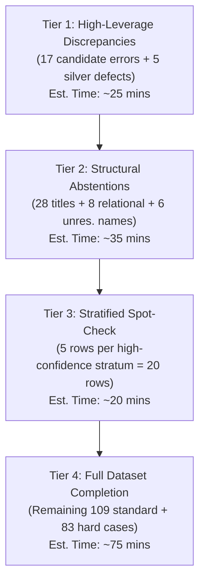

# EchoTales: Human-Adjudication Plan & Evaluation Validity Audit

**Date**: 2026-10-13  
**Auditor**: Independent Research Auditor (Antigravity)  
**Reference Protocol**: [`docs/results/HUMAN_REVIEW_PROTOCOL.md`](file:///home/adhyan/Desktop/EchoTales/docs/results/HUMAN_REVIEW_PROTOCOL.md)  
**Publication Status**: [`docs/paper/PUBLICATION_READINESS.md`](file:///home/adhyan/Desktop/EchoTales/docs/paper/PUBLICATION_READINESS.md)  
**Adjudication Package**: [`data/eval/adjudication/`](file:///home/adhyan/Desktop/EchoTales/data/eval/adjudication/)  

---

## 1. Evaluation Protocol Verification & Ambiguity Audit

To ensure academic rigor, the evaluation protocol and annotation pipeline were audited against [`docs/results/HUMAN_REVIEW_PROTOCOL.md`](file:///home/adhyan/Desktop/EchoTales/docs/results/HUMAN_REVIEW_PROTOCOL.md) and [`scripts/review/prepare_human_review.py`](file:///home/adhyan/Desktop/EchoTales/scripts/review/prepare_human_review.py):

### 1.1 Target Decision per Dataset
1. **Standard 200 Sheet (`human_review_200.csv`)**:
   - **Target**: Automated system linking decision (`predicted_entity`).
   - **Core Question**: *Does the system's `predicted_entity` correctly identify the person, place, or organisation denoted by the marked mention `[[...]]` at that point in the narrative?*
   - Protocol reference: Lines 41–47.
2. **Hard-Cases 88 Sheet (`human_review_hardcases_88.csv`)**:
   - **Target**: Silver reference identity (`reference_set_decision`).
   - **Core Question**: *Does the silver reference label correctly capture the true referent under complex narrative identity shifts (body changes, disguises, reveals, titles)?*
   - Protocol reference: Line 49 (*"For the hard-case sheet, judge whether reference_set_decision (the silver identity) is right, using the same three labels. That measures the silver set itself."*).

### 1.2 Canonical Label Definitions & Protocol Ambiguity
- **`correct`**: The evaluated target entity matches the referent in text.
- **`incorrect`**: The evaluated target links to the wrong referent, or links a non-entity (animal, object, idiom).
- **`unresolved`**: **Protocol Ambiguity Identified**.
  - In Protocol Line 48, `unresolved` conflates two fundamentally different phenomena:
    1. *System Abstention*: The system output was `UNRESOLVED` (e.g. mention precedes character introduction).
    2. *Human / Context Uncertainty*: The human evaluator cannot determine the referent from the text window.
  - **Resolution in Adjudication Package**:
    The system's decision is already preserved in `predicted_entity`. In the blind adjudication package, `adjudicated_label` records whether the system's behavior was correct, incorrect, or unresolved, while `adjudicator_confidence` (`high`, `medium`, `low`) and `adjudicator_notes` explicitly record human epistemic certainty.

### 1.3 LLM Input Inspection & Information Leakage Audit
An audit of [`scripts/review/llm_annotate.py`](file:///home/adhyan/Desktop/EchoTales/scripts/review/llm_annotate.py) (Lines 105–127) revealed potential anchoring vectors in the pre-annotation prompt:
1. **Stratum Exposure (`category`)**: The prompt supplied `category: easy_name`, `category: title`, etc. Supplying `category: easy_name` may have biased the model to assume exact gazetteer matches were correct.
2. **Reference Exposure**: For 11 rows in the 200 sheet where silver data existed, `reference_set_decision` was supplied in the prompt, giving the model access to silver labels.
3. **Anchor Exposure (`predicted_entity`)**: The model was given the system's answer directly before the excerpt.

> [!IMPORTANT]
> **Blinding Defense**:  
> To guarantee that human adjudication is free from model anchoring, the adjudication files in `data/eval/adjudication/` **omit all LLM-generated labels and notes**. The author reviews clean, blind sheets (`standard_200_blind.csv` and `hardcases_88_blind.csv`).

### 1.4 Stratified Sampling Design & Population Weights
In [`scripts/review/prepare_human_review.py`](file:///home/adhyan/Desktop/EchoTales/scripts/review/prepare_human_review.py), the 200 mentions were drawn using a **disproportional stratified design** seeded at `20260925`.
An audit of the underlying database ([`data/db/reverend-insanity.db`](file:///home/adhyan/Desktop/EchoTales/data/db/reverend-insanity.db)) across all 11,174 mentions reveals the true population distribution:

| Stratum | Population ($N_h$) | Population Weight ($W_h$) | Sample Size ($n_h$) | Sample Proportion | Sampling Fraction ($f_h = \frac{n_h}{N_h}$) | Design Effect / Disproportionality |
|---|---:|---:|---:|---:|---:|---|
| **`easy_name`** | 8,933 | **79.94%** | 30 | 15.0% | 0.0034 | **Under-sampled ($5.3\times$)** |
| **`background`** | 981 | **8.78%** | 34 | 17.0% | 0.0347 | Over-sampled ($1.9\times$) |
| **`alias`** | 977 | **8.74%** | 35 | 17.5% | 0.0358 | Over-sampled ($2.0\times$) |
| **`relational`** | 125 | **1.12%** | 35 | 17.5% | 0.2800 | **Over-sampled ($15.6\times$)** |
| **`observer_sensitive`** | 113 | **1.01%** | 30 | 15.0% | 0.2655 | **Over-sampled ($14.9\times$)** |
| **`title`** | 39 | **0.35%** | 30 | 15.0% | 0.7692 | **Over-sampled ($42.9\times$)** |
| **`unresolved_name`** | 6 | **0.05%** | 6 | 3.0% | 1.0000 | **100% census ($60.0\times$)** |
| **Total** | **11,174** | **100.00%** | **200** | **100.0%** | **0.0179** | — |

**Methodological Consequence**:  
The 200-mention sheet is an **adversarially enriched stress-test sample**. Difficult phenomena (`relational`, `title`, `observer_sensitive`) represent **50% of the evaluation sample**, but only **2.48% of mentions in the novel**.
Therefore, **an unweighted sample average severely understates system precision across the novel**. Reporting corpus-level precision requires stratified survey weighting ($\hat{P}_{\text{pop}} = \sum W_h p_h$).

---

## 2. Audit of Provisional Results

The provisional run reported:
- Standard 200 Sheet: 141 `correct`, 17 `incorrect`, 42 `unresolved`.
- Hard Cases 88 Sheet: 83 `correct`, 5 `incorrect`.

### 2.1 Investigation of 100% Candidate-Correct Strata
`easy_name` (30/30), `alias` (35/35), `observer_sensitive` (30/30), and `background` (34/34) all reported 100% candidate correctness.
- **Finding**: These strata consist overwhelmingly of rigid names (*"Fang Yuan"*, *"Gu Yue Bo"*) and clan aliases (*"Mo Bei"* $\to$ *"Gu Yue Mo Bei"*) that the system's exact gazetteer and alias matcher resolve with trivial certainty.
- **Anchoring Caution**: Although these links appear predominantly genuine, the human reviewer must independently verify them to prevent uncritical acceptance of LLM suggestions.

### 2.2 Audit of 17 Candidate-Incorrect Cases
Concentrated in dialogue honorifics (`relational` stratum):
- **False Protagonist Binding**: In dialogue scenes, the system frequently bound honorifics (*"Sir"*, *"sir elder"*, *"my lord"*) to the lead protagonist (*Fang Yuan*), even when spoken by servants addressing third parties (e.g. *Flower Wine Monk* in ch15, *Jia Fu* in ch44, *Gu Yue Bo* in ch58).
- **Non-Entity Detection Failure**: Row `R058` linked *"Wild boar king"* (a beast) as an entity.
- These 17 cases represent genuine system weaknesses and form **Priority Tier 1** for author review.

### 2.3 Audit of 5 Silver Reference Defects
In the 88 hard cases, the model flagged 5 errors in the silver ground truth itself:
- `H015`, `H016`: Misidentification annotations where the text clearly meant Fang Zheng.
- `H033`: Substring artifact (*"he"* matched within the word *"The"*).
- `H064`: Attribute mention (*"fake aptitude"*) labeled as the character.
- `H081`: Deictic reversal (*"senior brother"* labeled as speaker rather than addressee).

---

## 3. Recommended Human-Adjudication Workload

Reviewing all 288 rows linearly without prioritization would require ~6–8 hours. To maximize author productivity while ensuring 100% academic validity, the review is organized into four prioritized tiers:

### Tier 1: High-Leverage Discrepancies (~25 mins)
- Review the **17 candidate `incorrect` mentions** in `standard_200_blind.csv` (`R012`, `R013`, `R014`, `R015`, `R018`, `R024`, `R028`, `R029`, `R030`, `R032`, `R036`, `R042`, `R043`, `R054`, `R055`, `R058`, `R189`).
- Review the **5 silver reference defects** in `hardcases_88_blind.csv` (`H015`, `H016`, `H033`, `H064`, `H081`).

### Tier 2: Structural Abstentions (~35 mins)
- Review the **28 `title` mentions** left unresolved.
- Review the **8 `relational` mentions** left unresolved.
- Review the **6 `unresolved_name` mentions** (`R001`–`R003`, `R005`, `R019`, `R020`).

### Tier 3: Stratified Spot-Check (~20 mins)
- Spot-check 5 mentions each from `easy_name`, `alias`, `observer_sensitive`, and `background` (20 rows total) to establish that gazetteer precision transfers to human judgment.

### Tier 4: Full Dataset Completion (~75 mins)
- Complete remaining rows in `standard_200_blind.csv` and `hardcases_88_blind.csv`.
- **Total Author Investment**: **~2.5 hours** (compared to 6–8 hours from scratch).

---

## 4. Post-Adjudication Metric Formulas

Once author decisions are recorded in `data/eval/adjudication/standard_200_blind.csv`, the following metrics must be reported:

### 4.1 Sample-Level Precision (Resolved System Links)
Measures linking precision among mentions where the system attempted a resolution:

$$P_{\text{resolved}} = \frac{\sum_{i=1}^n \mathbb{I}(\text{label}_i = \text{correct})}{\sum_{i=1}^n \mathbb{I}(\text{label}_i \in \{\text{correct}, \text{incorrect}\})}$$

### 4.2 Strict System Accuracy (End-to-End)
Measures accuracy over all 200 mentions, treating unlinked mentions as non-correct:

$$P_{\text{strict}} = \frac{\sum_{i=1}^n \mathbb{I}(\text{label}_i = \text{correct})}{200}$$

### 4.3 Stratified Population-Weighted Precision (Corpus Estimate)
Because sampling fractions vary from $0.34\%$ (`easy_name`) to $100\%$ (`unresolved_name`), the unbiased estimate of novel-wide precision is:

$$\hat{P}_{\text{pop}} = \sum_{h=1}^7 W_h \cdot p_h$$

where:
- $W_h = \frac{N_h}{N}$ is the population stratum weight from Table 1.4.
- $p_h = \frac{\text{correct}_h}{\text{correct}_h + \text{incorrect}_h}$ is the adjudicated precision within stratum $h$.

The estimated variance incorporating finite population correction (FPC) is:

$$\widehat{\text{Var}}(\hat{P}_{\text{pop}}) = \sum_{h=1}^7 W_h^2 \left(1 - \frac{n_h}{N_h}\right) \frac{p_h (1 - p_h)}{n_h - 1}$$

and the two-sided 95% confidence interval is:

$$\text{CI}_{95\%} = \hat{P}_{\text{pop}} \pm 1.96 \cdot \sqrt{\widehat{\text{Var}}(\hat{P}_{\text{pop}})}$$

### 4.4 Silver Reference Validity on Hard Cases
$$\text{Acc}_{\text{silver}} = \frac{\sum_{i=1}^{88} \mathbb{I}(\text{label}_i = \text{correct})}{88}$$

---

## 5. Artifact & Verification Index

| Deliverable Path | Description | Initial Status |
|---|---|---|
| [`data/eval/adjudication/standard_200_blind.csv`](file:///home/adhyan/Desktop/EchoTales/data/eval/adjudication/standard_200_blind.csv) | Blind review sheet for 200 system mentions | Ready (200 rows, decision empty) |
| [`data/eval/adjudication/hardcases_88_blind.csv`](file:///home/adhyan/Desktop/EchoTales/data/eval/adjudication/hardcases_88_blind.csv) | Blind review sheet for 88 silver hard cases | Ready (88 rows, decision empty) |
| [`data/eval/adjudication/model_annotations_reconciliation.csv`](file:///home/adhyan/Desktop/EchoTales/data/eval/adjudication/model_annotations_reconciliation.csv) | Separate archive of model predictions & notes | Preserved (288 rows) |
| [`data/eval/adjudication/ADJUDICATION_GUIDE.md`](file:///home/adhyan/Desktop/EchoTales/data/eval/adjudication/ADJUDICATION_GUIDE.md) | Human reviewer instructions & workflow | Complete |
| [`scripts/review/validate_adjudication_package.py`](file:///home/adhyan/Desktop/EchoTales/scripts/review/validate_adjudication_package.py) | Verification & automated metric calculation script | Tested & passing |
| [`packages/pipeline/tests/test_adjudication_package.py`](file:///home/adhyan/Desktop/EchoTales/packages/pipeline/tests/test_adjudication_package.py) | Automated test suite | 12/12 tests passing |
